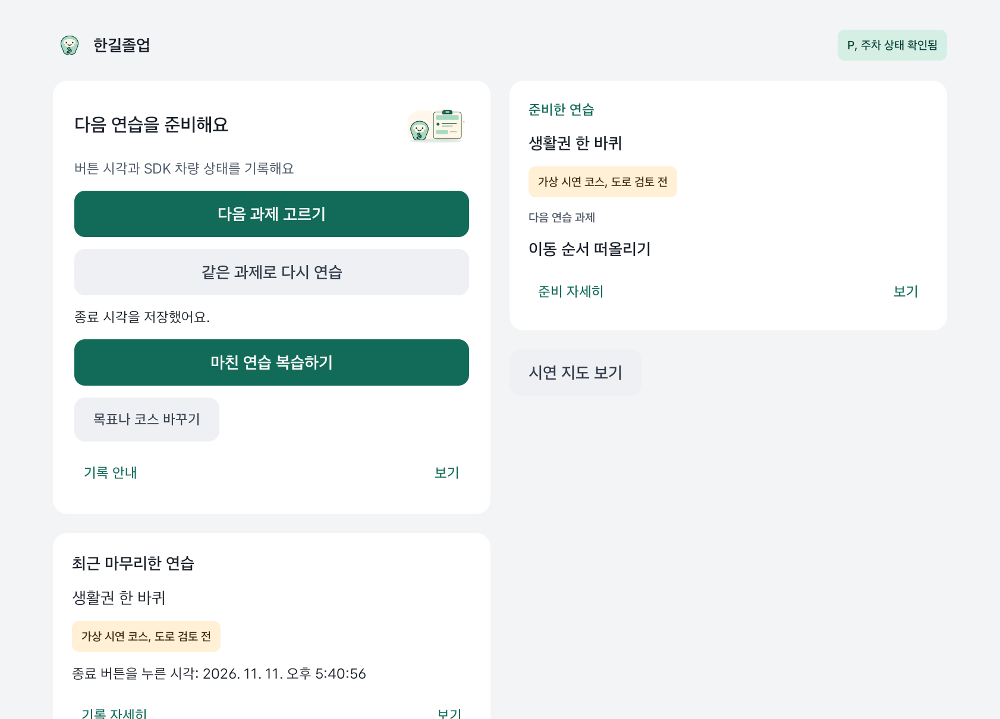
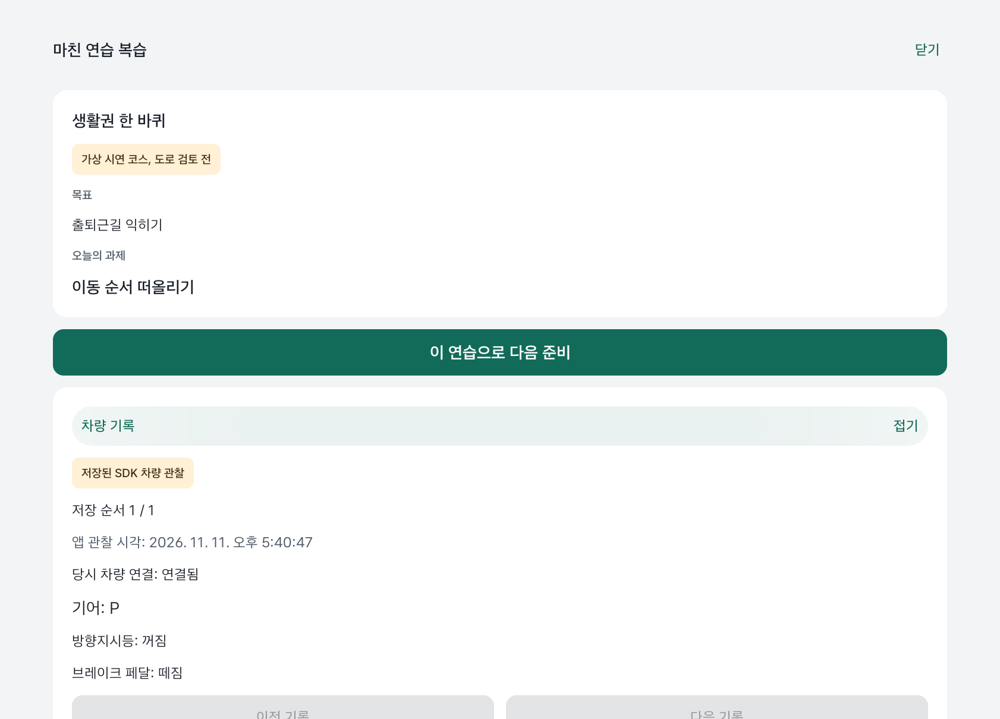
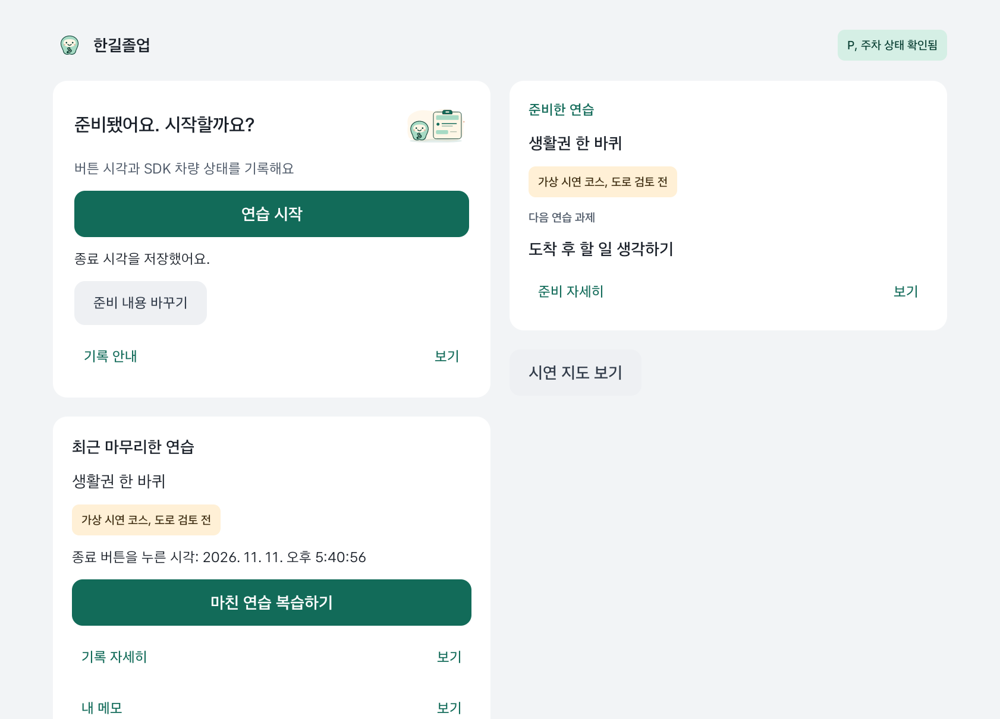
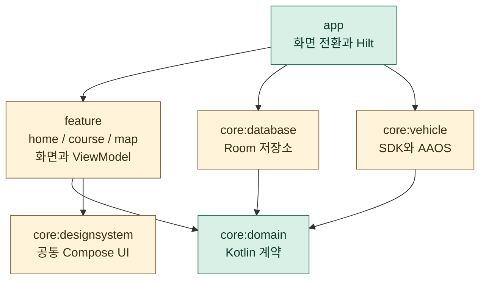

<div align="center">
  
  <h1>한길졸업</h1>
  <p><strong>내가 매일 가야 하는 길 하나부터, 내 힘으로.</strong></p>
  <p>생활 경로를 연습하는 Pleos 차량용 앱</p>
</div>

<br />

## 📄 목차

- [✍ 프로젝트 개요](#overview)
- [🚘 핵심 기능](#features)
- [⚙️ 기술 스택](#technology)
- [🏛️ 시스템 아키텍처](#architecture)
- [🔎 문제 해결](#problem-solving)
- [👤 개발자 소개](#developer)

<br />

<a id="overview"></a>

## ✍ 프로젝트 개요

운전이 오랜만인 면허 소지자가 자주 가는 길을 연습하는 앱입니다. 주차 중 목표와 과제를 정하고, 연습을 마치면 차량 기록과 메모를 보며 다음 과제를 고릅니다.

<a id="features"></a>

## 🚘 핵심 기능

**Pleos 에뮬레이터 시연 (1분 57초)**

https://github.com/user-attachments/assets/6311a39f-d6a9-47ab-af7c-41844c479160

| 홈 | 오늘의 과제 |
|:---:|:---:|
| [](docs/images/screenshots/hangil-home.png) | [](docs/images/screenshots/hangil-task.png) |

| 연습 중 | 연습 마무리 |
|:---:|:---:|
| [](docs/images/screenshots/hangil-recording.png) | [](docs/images/screenshots/hangil-practice-finished.png) |

| 저장된 차량 기록 | 다음 과제 저장 |
|:---:|:---:|
| [](docs/images/screenshots/hangil-vehicle-review.png) | [](docs/images/screenshots/hangil-next-practice-saved.png) |

- **준비** 목표, 코스, 과제를 저장합니다. 판교를 거쳐 양재까지 코스는 경유지와 도착지를 Pleos 기본 내비에 보낼 수 있습니다.
- **연습** 시작과 종료 시각, SDK가 전달한 기어, 방향지시등, 브레이크를 기록합니다. 위치 표본은 직접 켜면 한길 화면에서 기록합니다. 내비 사용 중에도 차량 상태를 기록하려면 별도로 켭니다.
- **복습** 지난 연습의 차량 기록과 위치 표본을 읽고 메모를 남깁니다. 공개 도로선을 복습 구간으로 골라 다음 과제와 함께 저장할 수 있습니다.
- **주차 확인** 기어 P와 화면 조작 허용을 모두 확인해야 준비, 복습과 상세 조작을 열 수 있습니다.

화면의 코스는 시연용입니다. 복습에서는 시연 코스, 저장된 SDK 관찰, 사용자가 남긴 메모의 출처를 각각 표시합니다.

<a id="technology"></a>

## ⚙️ 기술 스택

Kotlin, Jetpack Compose, Coroutines, Hilt, Room, MapLibre, Pleos Vehicle SDK, FusedLocation, NaviHelper

<a id="architecture"></a>

## 🏛️ 시스템 아키텍처



화살표는 주요 모듈 의존 방향입니다. `app`이 Hilt로 Room 저장소와 Pleos 어댑터를 연결하고, 화면의 ViewModel은 `core:domain` 계약을 사용합니다.

차량 어댑터가 읽은 기어와 AAOS 제한으로 상세 조작을 판정합니다. 복습을 열면 Room에서 선택한 종료 기록을 읽습니다. 차량 관찰과 메모는 각 영역을 펼칠 때, 위치 표본은 위치 기록 화면을 열 때 불러옵니다.

<a id="problem-solving"></a>

## 🔎 문제 해결

### 1. 방금 마친 연습을 복습에서 다시 열기

**문제** 연습을 마친 뒤 이력을 열면, 그 사이 저장된 다른 연습이 표시될 수 있었습니다. 방금 마친 기록을 바로 여는 경로를 붙인 뒤에는 이미 닫힌 화면의 조회가 정상 복습 화면을 잠그는 문제도 재현됐습니다.

**원인** 마침 응답에 종료 기록이 있었지만 화면에는 완료 메시지만 남았습니다. 새 조회는 Job과 화면 상태를 확인하기 전에 공유 reader를 교체했습니다.

**해결** Room 트랜잭션에서 종료 전에 기록 전체를 대조했습니다. 저장 응답과 이력에서 읽은 종료 원본이 일치할 때 복습 요청을 한 번 소비하고, 조회 Job과 화면이 유효할 때만 reader를 등록했습니다.

**결과** 다른 종료 기록이 생겨도 방금 마친 연습이 열렸습니다. 주행 중 잠겼다가 주차와 조작 허용이 돌아오면 같은 기록에서 복습을 이어갔습니다. 취소된 조회도 정상 조회를 덮지 못했습니다. 전후 성능은 미측정입니다.

**대체안/회고** ID가 같아도 코스나 과제 내용이 바뀔 수 있어 기록 전체를 대조했습니다. 화면은 앱이 DB에서 받아 온 변경을 기준으로 복습을 허용합니다.

**코드**

```kotlin
if (mutation.isLocked || operation.value == SessionOperationState.Saving ||
    receipts.value !== receipt || !finishAccessLocked(canKeepOpen) || receipts.value !== receipt ||
    currentRecordsLocked()?.singleOrNull { it.sessionId == receipt.source.sessionId } != receipt.source
) {
    return@synchronized null
}
receipts.value = null
acknowledgedFinish = null
receipt.source
```

```kotlin
owner.job.ensureActive()
if (entry is SessionHistoryEntry.FinishedReview && !hostAllowed(owner)) return@synchronized false
owner.job.ensureActive()
invalidateDeletionLocked()
reader = owner
ended = null
```

### 2. 위치 표본이 쌓여도 저장 지연 줄이기

**문제** 연습 중 위치 표본을 추가할 때마다, 이미 저장한 표본이 많을수록 쓰기 트랜잭션이 오래 걸렸습니다.

**원인** 다음 순번과 직전 수신 시각을 결정하려고 같은 연습의 모든 표본을 Kotlin 객체로 변환하고, 실행별로 다시 묶었습니다.

**해결** 정상 형태의 기존 행은 SQL에서 자료형, 시간과 순번을 검사하고 현재 실행의 마지막 표본만 변환합니다. SQL에서 확정할 수 없는 행은 기존 전체 검증으로 넘깁니다. 다음 표본 추가와 커밋 직전 권한 확인은 같은 트랜잭션에서 합니다.

**결과** Pleos API 34 에뮬레이터의 debug 빌드에서 합성 표본이 1,023개인 실행에 다음 표본을 저장했습니다. 커밋까지 중앙값은 23.69ms에서 9.18ms로 줄어 14.51ms(61.3%) 감소했고, p95는 33.36ms에서 13.18ms로 줄었습니다. 전후 APK를 번갈아 두 번씩 실행하고, 매번 예열 10회 뒤 전후 각 80회를 측정했습니다.

**대체안/회고** 마지막 행만 읽으면 그보다 앞선 행의 손상이나 순번 누락을 놓칩니다. 기존 행은 계속 검사하되, 정상 표본을 매번 객체로 만들던 비용을 줄였습니다. 오류 메타데이터가 있어 전체 검증으로 돌아가는 입력은 이 측정에 포함하지 않았습니다.

**코드**

```kotlin
val runs = readRuns(sessionId)
return if (dao.needsEventDecoding(sessionId, LocationRecordingRepository.MAX_EVENTS_PER_RUN)) {
    readEvents(sessionId, runs).lastOrNull { it.runId == runId }
} else {
    dao.lastEvent(sessionId, runId)?.event()
}
```

### 3. 주행으로 바뀐 뒤 이전 지도 입력 차단하기

**문제** 제어 입력으로 주행 상태를 전달했을 때 화면에 이전 주차 지도가 잠시 남았습니다. 이때 드래그하면 카메라가 움직였습니다.

**원인** Compose에 잠금이 그려지기 전에 MapView가 입력을 받았습니다. 코스가 바뀐 뒤 이전 View에서 늦게 도착한 렌더 완료도 새 지도 상태에 영향을 줄 수 있었습니다.

**해결** 조회와 렌더 완료에 현재 준비 원본과 View 토큰을 연결했습니다. 네이티브 전달 직전에 최신 주차 상태와 조작 허용 여부를 읽고, 같은 첫 터치에서 이어진 입력인지 검사했습니다.

**결과** 제어 입력에서 이전 화면의 드래그와 휠을 막았습니다. 실제 Pleos에서 P→D→P로 바꿔 지도 제거와 복귀를 확인했습니다. 위와 같은 환경에서 예열 5회 후 지도 진입을 전후 각 30회 측정했습니다. 중앙값은 2127.52ms에서 2000.33ms로 127.19ms(5.98%) 차이가 났습니다. 사분위 범위가 겹쳐 성능 향상 여부는 미확정입니다.

**대체안/회고** 터치 리스너만으로는 자식 View 입력과 이미 예약된 지도 작업까지 정리하기 어려웠습니다. 네이티브 전달 지점에서 입력을 검사하고 허용이 끝나면 진행 중인 제스처를 취소했습니다.

**코드**

```kotlin
return current.id == attempt && current.token == token && current.load == MapLoadState.READY &&
    canRender(current) && render.value === current
```

```kotlin
validTime(downTime, eventTime, now) && downTime >= permittedAt &&
    touch?.let {
        owns(it.epoch) && it.downTime == downTime && it.deviceId == deviceId && it.source == source
    } == true
```

### 4. 내비에서 돌아온 뒤 차량 기록 상태 복원하기

**문제** Pleos에서 시스템 런처로 기본 내비를 열자 같은 연습에 차량 기록이 계속 쌓였습니다. 한길로 돌아와 배경 기록을 끄면 전면 기록은 다시 저장됐지만 화면에는 일시 중지가 남았습니다.

**원인** 소유권을 반환하자 StateFlow를 보던 전면 수집이 즉시 재개됐습니다. 배경 실행의 정리 코드가 뒤에서 Paused를 써 새 상태를 덮었습니다.

**해결** 배경 실행을 정리하고 화면 상태를 먼저 쓴 뒤 마지막에 소유권을 반환했습니다. 이전 프로세스가 종료 기록을 남기지 못한 실행은 다시 열 때 종료 시각을 알 수 없는 중단으로 표시했습니다.

**결과** Pleos 기본 라이트와 확대 다크에서 배경 기록을 끈 뒤 같은 연습의 전면 수집과 화면 표시가 함께 돌아왔습니다. 앱 프로세스를 종료한 시험에서는 재실행 후 이전 기록이 중단 상태로 남았습니다. 전후 성능은 미측정입니다.

**대체안/회고** 기록을 끈 직후 무조건 기록 중으로 표시하면 활성 연습이 없는 경우도 틀립니다. 전면 수집기가 현재 연습을 확인해 다음 상태를 정하도록 했습니다.

**코드**

```kotlin
currentBackground.value =
    if (cleanupFailed) {
        BackgroundRecordingState.Failed(null, request.source.sessionId, checkNotNull(failure))
    } else {
        BackgroundRecordingState.Disabled
    }
currentState.value = VehicleRecordingState.Paused
owner.value = null
```

<a id="developer"></a>

## 👤 개발자 소개

2026년 10월부터 기획, 디자인, Android 개발을 혼자 맡았습니다.
