<div align="center">
  
  <h1>한길졸업</h1>
  <p><strong>내가 매일 가야 하는 길 하나부터, 내 힘으로.</strong></p>
  <p>생활 경로 연습을 준비하고 기록하는 Pleos 차량용 앱</p>
</div>

<br />

## 📄 목차

- [✍ 프로젝트 개요](#overview)
- [🚘 핵심 기능](#features)
- [⚙️ 기술 스택](#technology)
- [🏛️ 시스템 아키텍처](#architecture)
- [🔎 문제 해결](#problem-solving)
- [👤 개발자 소개](#developer)

<br />

<a id="overview"></a>

## ✍ 프로젝트 개요

운전이 익숙하지 않은 성인이 매일 가야 하는 길을 스스로 연습할 수 있도록 돕습니다.
주차 중에 목표와 코스를 준비하고, 연습의 시작과 마무리를 기록합니다.

| 항목 | 내용 |
|---|---|
| 개발 기간 | 2026.10.26 ~ 현재 |
| 구성 | 1인 개발 |
| 담당 | 기획, 디자인, Android 개발 |
| 출품 | Pleos 차량용 앱 공모전 출품 준비 중 |

<br />

<a id="features"></a>

## 🚘 핵심 기능

**목표 선택 → 코스와 과제 준비 → 연습 시작 → 마무리 기록 → 주차 후 메모 → 다음 과제 준비**

실제 Pleos 에뮬레이터에서 동작을 확인한 앱 화면입니다. 코스와 과제는 고정 시연 내용입니다. 버튼을 누른 시각과 실제 SDK 차량 상태 관찰은 별도로 기록하며, 차량 상태는 기본적으로 활성 연습 중 앱 화면이 켜진 동안 기록하며, 사용자가 내비 중 기록을 켠 경우에만 화면 밖에서도 이어갑니다. 위치와 실제 경로는 수집하지 않습니다. 사진을 누르면 원본 크기로 볼 수 있습니다.

| 홈과 연습 기록 | 목표 선택 |
|:---:|:---:|
| [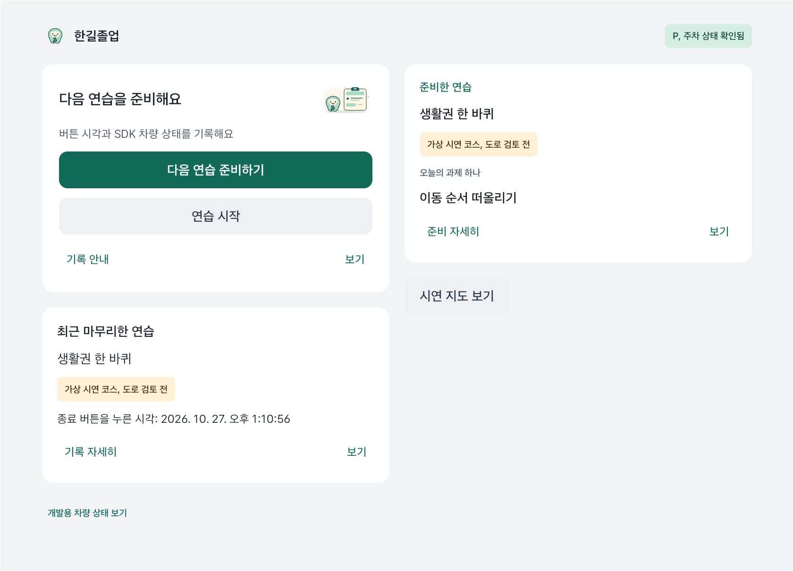](docs/images/screenshots/hangil-home.png) | [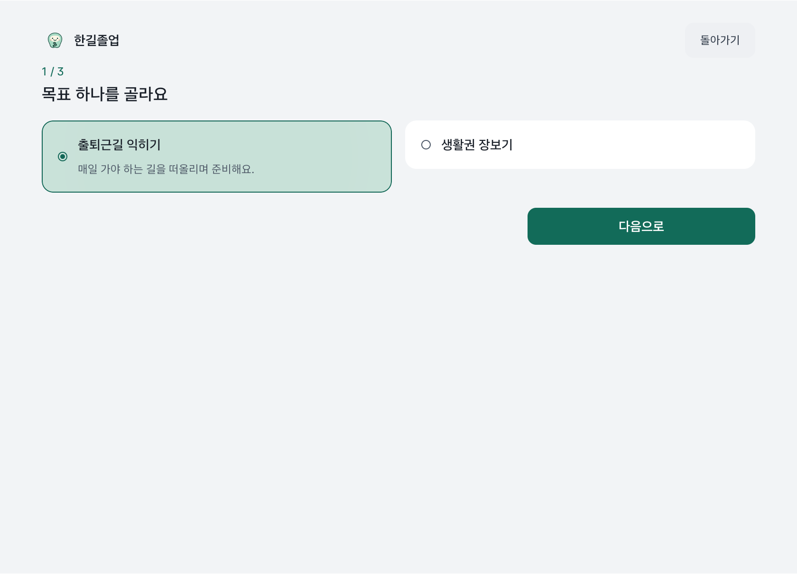](docs/images/screenshots/hangil-goal.png) |

| 시연 코스 선택 | 오늘의 과제 |
|:---:|:---:|
| [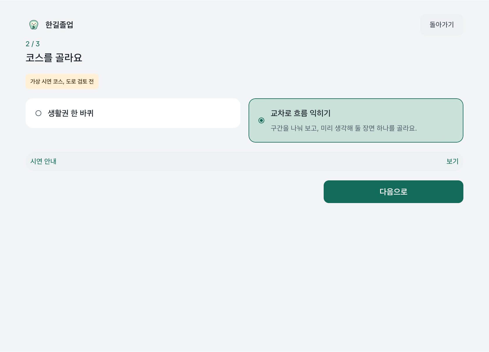](docs/images/screenshots/hangil-course.png) | [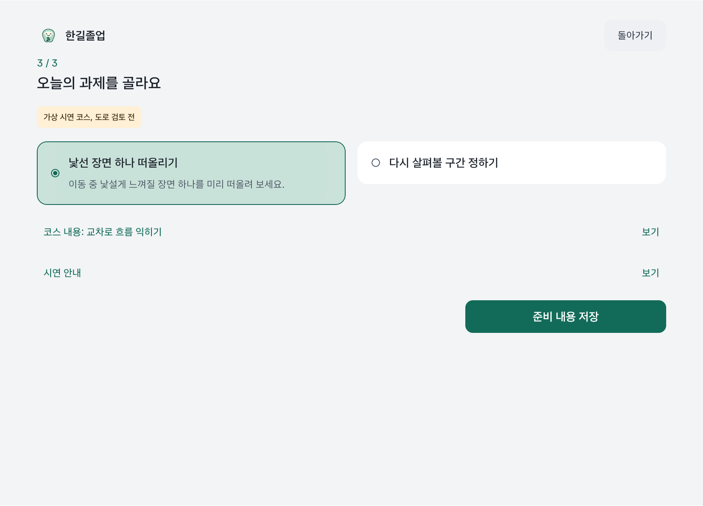](docs/images/screenshots/hangil-task.png) |

| 생활권 코스의 시연 지점 | 교차로 코스의 시연 지점 |
|:---:|:---:|
| [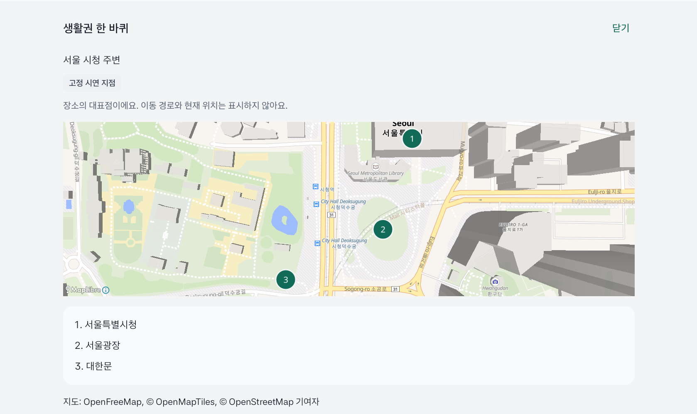](docs/images/screenshots/hangil-map-neighborhood.png) | [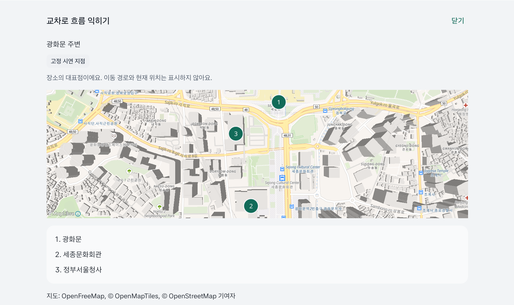](docs/images/screenshots/hangil-map-intersections.png) |

지도 번호는 공개 장소의 고정 대표점입니다. 실제 이동 경로, 방문 순서나 차량 목적지를 뜻하지 않습니다.

| SDK 차량 상태 기록 | 주행 중 상세 조작 잠금 |
|:---:|:---:|
| [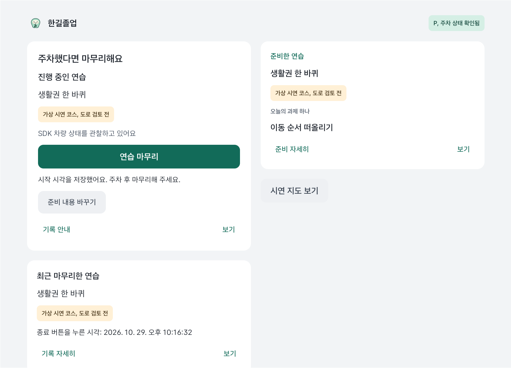](docs/images/screenshots/hangil-recording.png) | [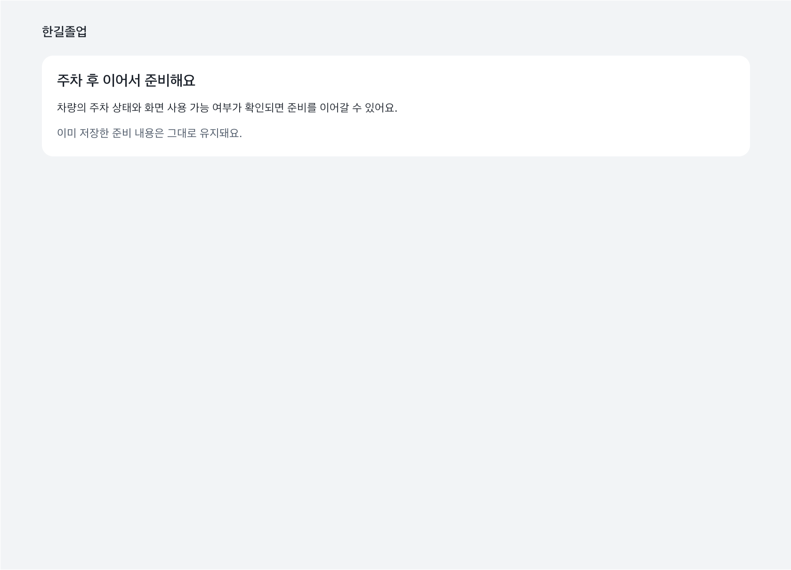](docs/images/screenshots/hangil-driving-locked.png) |

| 주차 후 저장된 차량 기록 확인 |
|:---:|
| [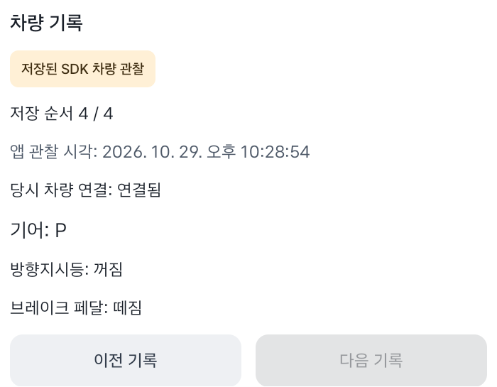](docs/images/screenshots/hangil-vehicle-review.png) |

| 지난 연습의 당시 준비 | 확대 글자와 다크 |
|:---:|:---:|
| [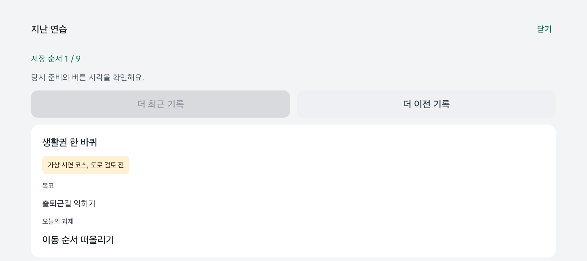](docs/images/screenshots/hangil-history.png) | [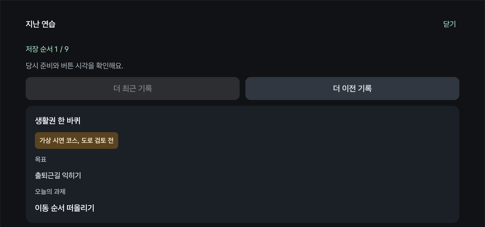](docs/images/screenshots/hangil-history-dark.png) |

| 같은 코스에 남긴 마무리 기록, 기본/확대 다크 |
|:---:|
| [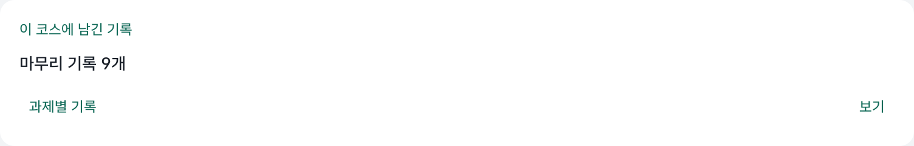](docs/images/screenshots/hangil-history-summary.png) |
| [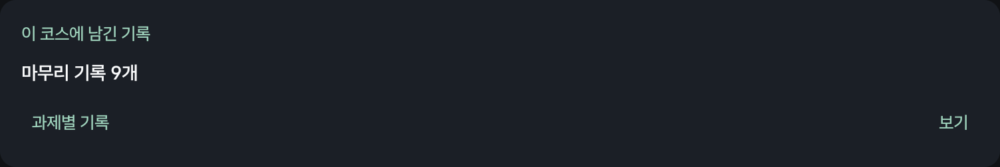](docs/images/screenshots/hangil-history-summary-dark.png) |

| 같은 코스의 다음 과제 선택 | 확대 글자와 다크 |
|:---:|:---:|
| [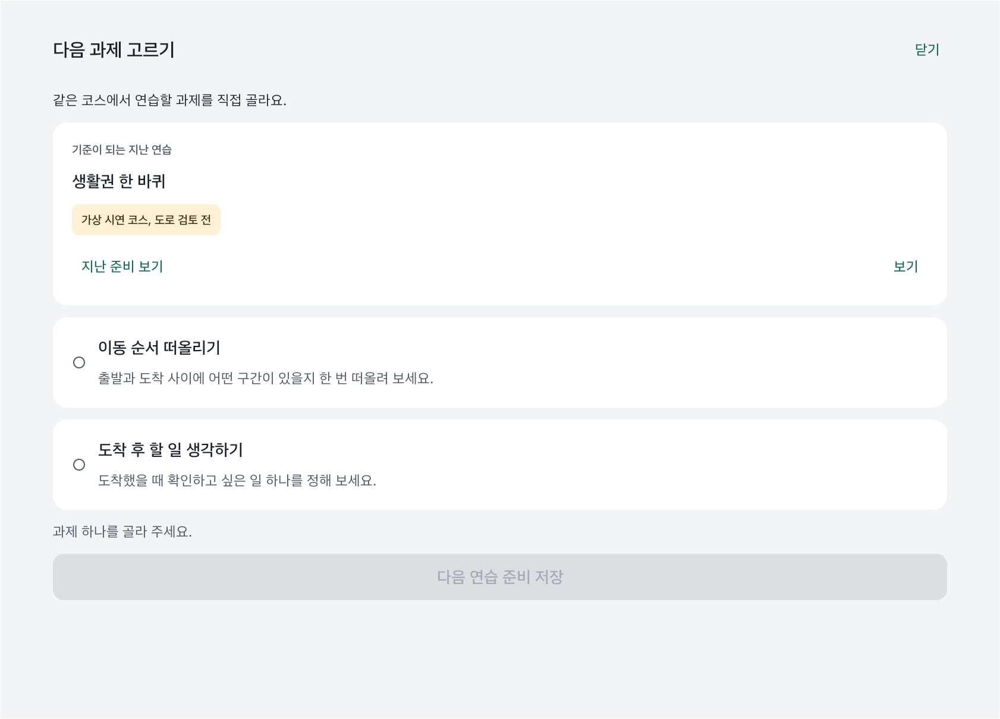](docs/images/screenshots/hangil-next-practice.png) | [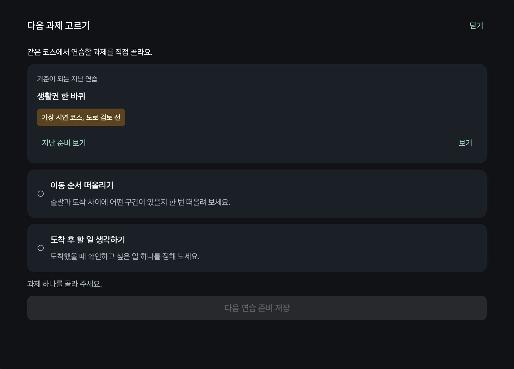](docs/images/screenshots/hangil-next-practice-dark.png) |

| 메모 입력, 확대 글자와 다크 | 재실행 후 저장 메모 복원 |
|:---:|:---:|
| [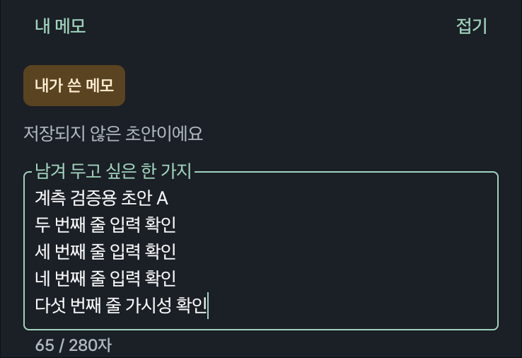](docs/images/screenshots/hangil-memo-input.png) | [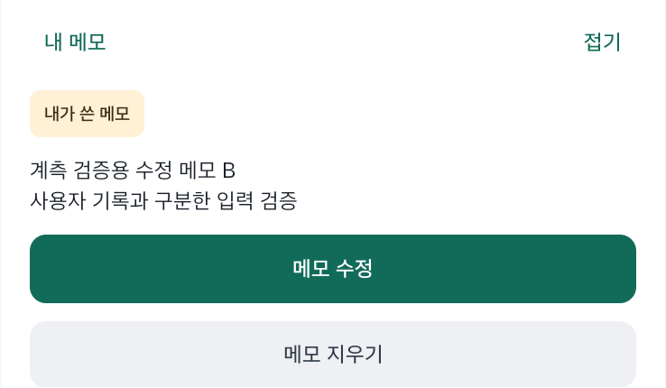](docs/images/screenshots/hangil-memo-restored.png) |

메모 화면의 문장은 동작 확인을 위해 직접 입력한 예시입니다. SDK 차량 기록과 별도로 저장하며, 주차와 UX 허용을 확인한 경우에만 열고 편집합니다.

| 기능 | 할 수 있는 일 |
|---|---|
| **목표와 코스 선택** | 생활 속 연습 목표를 고르고 두 가지 시연용 코스의 설명을 살펴봅니다. |
| **출발 전 브리핑과 오늘의 과제** | 선택한 코스의 확인 사항을 읽고 이번 연습에서 집중할 과제 하나를 정합니다. |
| **준비 내용 저장과 복원** | 목표, 코스와 과제를 기기에 저장하고 앱을 다시 열어 이어서 확인합니다. |
| **연습 시작과 마무리** | 시작과 종료 시각, 당시 코스와 과제를 저장하고 홈에서 최근 연습과 다음 행동을 확인합니다. |
| **활성 연습의 차량 상태 관찰** | SDK가 전달한 기어, 방향지시등과 브레이크 상태를 활성 연습에 기록합니다. 기본은 앱 화면이 켜진 동안만 수집하며, 주차와 UX 허용을 확인하고 사용자가 내비 중 기록을 켠 경우에만 화면 밖에서도 이어갑니다. 미확인, 미지원, 거부와 오류를 보존합니다. |
| **주차 후 차량 기록 확인** | 최근 종료 세션과 지난 연습에서 선택한 종료 기록의 저장된 SDK 관찰을 한 번에 하나씩 확인합니다. 당시 기어, 방향지시등과 브레이크, 연결과 앱 관찰 시각을 보고 이전/다음으로 저장 순서를 따라갑니다. |
| **지난 연습 열람** | 종료 이력을 저장 순서대로 한 번에 하나씩 확인합니다. 당시 목표, 코스, 과제와 시작/마무리 버튼 시각을 보여 주며, 이탈과 주행 잠금 후에도 같은 기록으로 돌아옵니다. |
| **저장된 배경 기록 실행 확인** | 선택한 종료 이력의 배경 기록 실행을 펼쳐 저장 순서와 시작/종료 기록을 읽습니다. 종료를 확인하지 못한 이전 실행을 계속 표시하며, 저장된 상태를 현재 수집 중이라는 의미나 실제 SDK 수집 구간으로 해석하지 않습니다. |
| **기기 내 종료 기록 삭제** | 지난 연습에서 종료 기록을 직접 골라 확인 후 연결된 차량 관찰과 메모를 함께 지웁니다. 진행 중 연습, 다른 기록과 준비는 보존합니다. |
| **코스별 마무리 기록 요약** | 저장 당시 목표, 코스, 버전과 표시 정보가 같은 마무리 기록을 모아 과제별 저장 기록 수를 확인합니다. |
| **과정 마무리 직접 기록** | 선택한 종료 연습의 당시 목표, 시연 코스와 과제를 확인하고 마무리 선언을 한 번 저장합니다. 사용자 선언과 버튼 시각을 같은 기록에서 다시 읽으며 운전 능력 인증으로 표시하지 않습니다. |
| **같은 코스의 다음 과제 준비** | 최근 마무리한 연습의 목표와 시연 코스를 다시 확인하고 다음 과제 하나를 직접 골라 저장합니다. 선택이나 취소만으로 기존 준비를 바꾸지 않으며 새 연습은 별도로 시작합니다. |
| **주차 후 사용자 메모** | 최근 마무리한 연습에 짧은 메모를 직접 입력하고 저장, 수정, 명시적으로 지웁니다. 지난 연습에서는 선택한 종료 기록에 이미 저장된 메모를 원문과 사용자 출처로 읽고 수정합니다. 저장 여부를 확인하지 못하면 다시 읽어 확인하며 자동으로 재저장하지 않습니다. 저장 내용은 앱을 다시 열어도 복원하며 미저장 초안과 구분합니다. |
| **주차 후 기본 내비 열기** | 주차와 UX 허용을 확인한 뒤 기본 내비 화면 전환을 요청합니다. 목적지는 보내지 않으며 요청 안내와 실제 화면 전환을 구분합니다. 실제 전면 전환과 요청 후 한길 화면에 머무르는 경우를 모두 확인했으며, 요청만으로 전환 성공을 표시하지 않습니다. |
| **코스별 시연 지도** | 준비한 코스에 맞춰 서울 시청 또는 광화문 주변의 공개 장소 세 곳을 번호로 표시합니다. 지도 번호를 짧게 누르거나 목록에서 고르면 같은 지점의 테두리와 설명을 보여 줍니다. 시연 출처와 지도 출처를 구분하고 실제 이동 경로나 현재 위치로 표현하지 않습니다. |
| **주행 중 상세 조작 잠금** | 주차와 UX 허용을 모두 확인해야 상세 조작을 허용합니다. 주행이나 상태 미확인에서는 준비 화면과 지도 조작을 잠급니다. |

<br />

<a id="technology"></a>

## ⚙️ 기술 스택

| 영역 | 기술 |
|---|---|
| 언어 | Kotlin 2.2.21 |
| 화면 | Jetpack Compose, Material 3 |
| 상태와 비동기 | ViewModel, Coroutines 1.10.2, StateFlow |
| 의존성 주입 | Hilt 2.57.2 |
| 로컬 저장 | Room 2.8.5, SQLite |
| 차량 상태 | Pleos Vehicle SDK 2.3.2 |
| 지도 표시 | MapLibre Android 13.5.0 |
| 기본 내비 화면 | Pleos NaviHelper 3.0.5 |
| 빌드 구성 | Gradle Kotlin DSL, Version Catalog, convention plugin |

<br />

<a id="architecture"></a>

## 🏛️ 시스템 아키텍처

화면은 domain 계약을 사용하고, 차량 SDK와 저장 구현은 각각의 어댑터 모듈에 둡니다.
`app`은 진입점과 의존성 연결을 담당합니다.

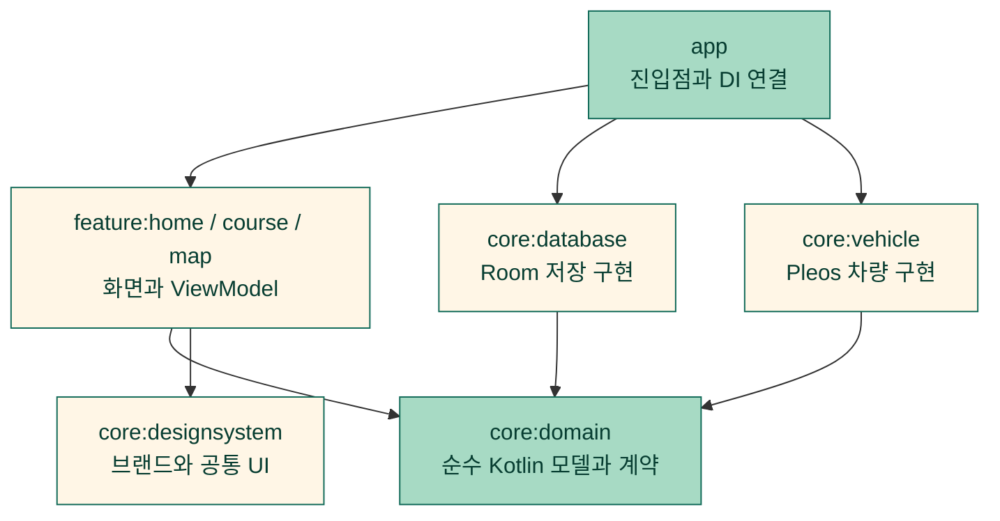

<br />

<a id="problem-solving"></a>

## 🔎 문제 해결

상태 경합과 데이터 보존 문제를 해결한 실제 구현 사례 4개입니다.

### 1. 화면 갱신보다 먼저 도착한 주행 상태로 상세 조작 차단

**문제**

주차 중 표시한 버튼이 화면에 남아 있는 순간 D 상태가 도착하면, UI 갱신 전에 눌린 상세 조작이 실행될 수 있습니다. 접힌 이력 상세를 펼치거나 화면에 다시 들어왔을 때 옛 버튼이 새 기록을 여는 경계도 함께 다뤘습니다. UX 제한 해제만으로 주차를 추정하지 않습니다.

**원인**

차량 기어와 UX 제한은 서로 다른 상태 스트림이라 화면이 마지막으로 조합한 P와 최신 D 값이 잠시 다를 수 있었습니다. 펼침 콜백에서 로컬 expanded만 바꾸는 흐름을 추적하니 자식의 재구성이 부모 Route의 주차 판정을 다시 실행한다는 보장도 없었습니다. 정상 종료한 자료 스트림이 UI에 새 실패 상태를 발행하지 않으면 열린 상세가 남는 문제도 확인했습니다.

**해결**

주차 확인과 UX 제한 해제를 모두 요구하는 판정을 domain에 두었습니다. 상세를 여는 순간과 내용을 구성하기 직전에 최신 차량 값, 표시한 원본과 조회 세대를 확인합니다. 화면의 STARTED 수명마다 새 소유권을 발급하고 STOP/폐기 뒤 옛 콜백은 다시 허용하지 않습니다. 거부한 펼침 의도는 버리고 접기는 항상 허용합니다. 자료 스트림의 정상 종료도 실패 상태로 발행하되 화면 이탈에 따른 취소는 오류로 바꾸지 않습니다.

**결과**

화면이 이전 주차 상태를 표시해도 최신 D, 미확인, 연결 끊김이나 UX 제한에서는 상세를 새로 펼치지 않습니다. 다른 기록 선택과 화면 재진입 뒤에도 옛 버튼이 새 상세를 열지 않으며, P와 UX 허용으로 돌아와도 거부했던 요청이 자동 실행되지 않습니다. 현재 유효한 기록은 사용자가 다시 선택해 읽을 수 있습니다.

**대체안/회고**

버튼 비활성화나 부모 화면의 재구성에만 의존하면 처리 사이의 틈이 남습니다. rememberUpdatedState로 콜백을 최신 것으로 교체하는 방법은 옛 동작이 새 원본의 허용 조건을 빌릴 수 있어 사용하지 않았습니다. 열 때의 원본/수명과 현재 허용 조건을 함께 확인하는 방식을 택했습니다. 이미 수신한 상태를 기준으로 제한하며 아직 전달되지 않은 상태 전환을 예측하거나 차량을 제어하지는 않습니다.

**코드**

[주차와 UX 조건을 함께 판단하는 상태](core/domain/src/main/kotlin/io/github/hangillab/hangil/core/domain/DrivingRestrictions.kt#L3-L9)

```kotlin
data class DrivingRestrictions(
    val parkingState: ParkingState = ParkingState.UNKNOWN,
    val uxRestrictionState: UxRestrictionState = UxRestrictionState.UNKNOWN,
) {
    val allowsDetailedInteraction: Boolean
        get() = parkingState == ParkingState.PARKED && uxRestrictionState == UxRestrictionState.UNRESTRICTED
}
```

[최신 차량 상태와 제한 상태 재확인](core/domain/src/main/kotlin/io/github/hangillab/hangil/core/domain/PracticeInteraction.kt#L4-L9)

```kotlin
fun allowsPracticeInteraction(
    vehicle: VehicleState,
    restrictions: DrivingRestrictions,
): Boolean =
    restrictions.allowsDetailedInteraction &&
        vehicle.toDrivingRestrictions(restrictions.uxRestrictionState).allowsDetailedInteraction
```

[표시한 원본과 조회 세대를 최신 reader에서 재확인](feature/home/src/main/kotlin/io/github/hangillab/hangil/feature/home/SessionHistoryViewModel.kt#L172-L185)

```kotlin
fun canRevealSummary(
    expectedSessionId: String,
    expectedGeneration: Long,
): Boolean =
    synchronized(lock) {
        val owner = reader ?: return@synchronized false
        val query = owner.query ?: return@synchronized false
        if (!currentQuery(owner, query) || !canRead()) return@synchronized false
        val current = published.value as? SessionHistoryUiState.Ready ?: return@synchronized false
        val records = ended ?: return@synchronized false
        !selectionLost && selectedId == expectedSessionId &&
            current.session.sessionId == expectedSessionId && current.generation == expectedGeneration &&
            records.getOrNull(current.index) == current.session && current.summary.source == current.session
    }
```

[열 때의 수명과 허용 조건을 직접 캡처한 펼침 처리](core/designsystem/src/main/kotlin/io/github/hangillab/hangil/core/designsystem/ParkedDisclosure.kt#L76-L91)

```kotlin
val clickOwner = startedOwner

fun ownsStartedContext(): Boolean = clickOwner.get() && lifecycle.currentState.isAtLeast(Lifecycle.State.STARTED)

fun mayRender(): Boolean = ownsStartedContext() && openingGuard?.invoke() == true && canExpand()
val toggle: () -> Unit = {
    if (expanded) {
        // Closing is always permitted, including after a live denial or STOP.
        collapse()
    } else if (ownsStartedContext() && canExpand()) {
        openingGuard = canExpand
        expanded = true
    } else {
        collapse()
    }
}
```

[내용 구성 직전 재검사와 거부한 의도 폐기](core/designsystem/src/main/kotlin/io/github/hangillab/hangil/core/designsystem/ParkedDisclosure.kt#L119-L124)

```kotlin
val renderExpanded = visibleExpanded && mayRender()
if (renderExpanded) Column(verticalArrangement = Arrangement.spacedBy(HanGilSpacing.lg), content = content)
SideEffect {
    // A read-only guard failure must discard intent, not resurrect it after P returns.
    if (expanded && !renderExpanded) collapse()
}
```

### 2. 확인한 종료 기록만 연결 자료와 함께 원자적으로 삭제

**문제**

기존 이력에는 종료 기록을 지우는 경로가 없었습니다. 삭제 기능을 연결할 때는 사용자가 확인한 뒤에도 메모 수정, 다른 기록 선택이나 주행 상태 전환이 끼어들 수 있습니다. 세션 ID만으로 삭제하면 확인하지 않은 최신 메모까지 지우거나, 이전 화면의 확인이 재진입한 화면에서 실행될 수 있습니다. 세션과 연결된 차량 관찰, 메모를 서로 다른 쓰기로 나누어 지우면 일부 자료만 남을 수도 있습니다.

**원인**

확인창을 여는 조회와 실제 삭제는 서로 다른 시점입니다. 메모는 같은 문장을 다시 저장해도 변경 토큰이 바뀌며, 메모가 없던 상태도 새 입력으로 달라집니다. 목록 갱신, 화면 수명과 DB 작업의 완료 순서도 같지 않아 행이 사라졌다는 통지만으로 삭제 성공을 판단할 수 없었습니다.

**해결**

확인 조회에서 종료 세션 전체 스냅샷, 연결 관찰 수, 메모 버전(null 포함), 기록 실행 구간과 사용자 마무리 선언 전체를 고정했습니다. 명시 확인은 하나의 nonce에 연결하고 최신 P/UX, reader/조회 세대/선택 원본과 STARTED 소유권을 다시 확인합니다. Room 트랜잭션 안에서 같은 스냅샷을 재비교한 뒤 부모 세션을 지우고, 기존 FK CASCADE로 연결 자료를 함께 삭제합니다. 쓰기 전후에 허용 조건과 취소를 확인해 commit 전에 거부되면 연결 삭제도 롤백합니다.

자기 삭제로 행이 사라진 통지는 처리 중인 요청에 연결해 보존하고 저장소의 명시적 결과를 기다립니다. 이미 없음, 진행 중, 변경 충돌과 차단은 완료로 바꾸지 않습니다.

**결과**

확인 뒤 메모, 선택, 조회나 화면 수명이 바뀌면 옛 확인을 버리고 새 확인을 요구합니다. 쓰기 뒤 차단된 요청은 부모와 연결 자료를 되돌리고, 다른 종료 기록, 진행 중 연습과 준비는 보존합니다. 저장소의 `Deleted` 결과를 받은 경우만 완료로 표시하며 다른 기록을 자동 선택하지 않습니다.

같은 이력 진입을 Android14/API34 Pleos/JDK17 debug/font1.0/라이트에서 전후 각각 워밍업5회 뒤 웜30회 측정했습니다. 중앙값263.03→260.93ms, 차이−2.11ms(−0.80%)로 관찰됐지만 사분위 분포가 겹치고 순차 실행의 캐시/발열을 통제하지 못해 성능 향상은 확정하지 않았습니다. 입력/동기화/표시 확인 비용을 포함한 [조건과 원값](docs/development/ended-session-deletion.md)을 남겼습니다. 이 값은 기존 이력 진입의 관찰이며, 이전에 없던 삭제 동작의 속도 전후 비교나 개선율을 뜻하지 않습니다.

**대체안/회고**

UI 버튼 잠금이나 프로세스 내부 Mutex만으로는 다른 저장 경로의 메모 변경을 통제하지 못해 DB 트랜잭션 안의 재비교를 선택했습니다. 자식을 각각 삭제하는 방식 대신 기존 FK CASCADE를 활용해 부모 삭제와 연결 자료 정리를 묶었습니다. 행 소실 관찰과 성공 응답을 구분하고, 확인할 때의 원본/수명과 쓰기 요청의 nonce를 함께 확인했습니다. commit 이후 화면을 닫았다고 이미 끝난 삭제를 소급 복구한다고 보장하지는 않습니다.

**코드**

[확인 조회에서 고정하는 종료 원본과 연결 자료 버전](core/domain/src/main/kotlin/io/github/hangillab/hangil/core/domain/SessionDeletionTarget.kt#L4-L10)

```kotlin
data class SessionDeletionTarget(
    val session: PracticeSession,
    val observationCount: Long,
    val memoVersion: String?,
    val recordingRuns: List<VehicleRecordingRun> = emptyList(),
    val completionDeclaration: CourseCompletionDeclaration? = null,
)
```

[같은 확인 nonce의 중복 실행과 바뀐 선택을 차단](feature/home/src/main/kotlin/io/github/hangillab/hangil/feature/home/SessionHistoryViewModel.kt#L457-L475)

```kotlin
fun confirmDeletion(nonce: Long): Boolean {
    val work =
        synchronized(lock) {
            val action = deletion?.takeIf { it.nonce == nonce } ?: return@synchronized null
            if (action.phase != DeletionPhase.CONFIRMING) return@synchronized null
            if (!currentDeletionContextLocked(action)) {
                invalidateDeletionLocked()
                return@synchronized null
            }
            val target = action.target ?: return@synchronized null
            val job = viewModelScope.launch(start = CoroutineStart.LAZY) { deleteSession(action, target) }
            action.phase = DeletionPhase.DELETING
            action.job = job
            deletionPublished.value = SessionDeletionUiState.Deleting(nonce, target)
            job
        } ?: return false
    work.start()
    return true
}
```

[쓰기 순간의 job, reader/조회/선택과 최신 차량 조건 재확인](feature/home/src/main/kotlin/io/github/hangillab/hangil/feature/home/SessionHistoryViewModel.kt#L620-L658)

```kotlin
private fun canCommitDeletion(
    action: DeletionAction,
    job: Job,
): Boolean =
    synchronized(lock) {
        action.phase == DeletionPhase.DELETING && action.job === job && job.isActive && currentDeletionContextLocked(action)
    }

private fun currentDeletionOwnerLocked(action: DeletionAction): Boolean =
    deletion === action && currentQuery(action.owner, action.query) &&
        selectedId == action.session.sessionId && canRead() && action.canKeepOpen()

private fun currentDeletionContextLocked(action: DeletionAction): Boolean =
    currentDeletionOwnerLocked(action) && !selectionLost &&
        currentSelectionLocked(action.session.sessionId, action.generation)?.session == action.session

private fun currentSelectionLocked(
    expectedSessionId: String,
    expectedGeneration: Long,
): SessionHistoryUiState.Ready? {
    if (!canRead()) return null
    return selectionSnapshotLocked(expectedSessionId, expectedGeneration)
}

/** Same received source check, without conflating a denied live value with an expired source. */
private fun selectionSnapshotLocked(
    expectedSessionId: String,
    expectedGeneration: Long,
): SessionHistoryUiState.Ready? {
    val owner = reader ?: return null
    val query = owner.query ?: return null
    if (!currentQuery(owner, query) || selectionLost || selectedId != expectedSessionId) return null
    val current = published.value as? SessionHistoryUiState.Ready ?: return null
    val records = ended ?: return null
    return current.takeIf {
        it.session.sessionId == expectedSessionId && it.generation == expectedGeneration &&
            records.getOrNull(it.index) == it.session && it.summary.source == it.session
    }
}
```

[실제 DB에서 확인 스냅샷을 재비교한 뒤 연결 자료까지 삭제](core/database/src/main/kotlin/io/github/hangillab/hangil/core/database/RoomSessionDeletionRepository.kt#L40-L64)

```kotlin
override suspend fun delete(
    target: SessionDeletionTarget,
    canCommit: () -> Boolean,
): SessionDeletionResult =
    try {
        database.withTransaction {
            requirePermission(canCommit)
            val actual = findCheckedSession(target.session.sessionId)
            val result =
                when {
                    actual == null -> SessionDeletionResult.Missing
                    actual.isActive -> SessionDeletionResult.Active
                    actual != target.session -> SessionDeletionResult.Changed
                    readTarget(actual) != target -> SessionDeletionResult.Changed
                    else -> {
                        check(database.practiceSessionDao().deleteFinished(actual.sessionId) == 1)
                        SessionDeletionResult.Deleted
                    }
                }
            requirePermission(canCommit)
            result
        }
    } catch (_: WriteBlocked) {
        SessionDeletionResult.Blocked
    }
```

[쓰기 전후 허용 조건과 코루틴 취소 확인](core/database/src/main/kotlin/io/github/hangillab/hangil/core/database/RoomSessionDeletionRepository.kt#L90-L95)

```kotlin
private suspend fun requirePermission(canProceed: () -> Boolean) {
    currentCoroutineContext().ensureActive()
    val allowed = canProceed()
    currentCoroutineContext().ensureActive()
    if (!allowed) throw WriteBlocked()
}
```

[자기 삭제의 행 소실 통지를 결과 도착 전까지 보존](feature/home/src/main/kotlin/io/github/hangillab/hangil/feature/home/SessionHistoryViewModel.kt#L686-L702)

```kotlin
private fun preserveDeletionReceiptLocked(
    owner: Reader,
    query: Query,
    records: List<PracticeSession>,
): Boolean {
    val action = deletion ?: return false
    if (action.owner !== owner || action.query !== query || !currentDeletionOwnerLocked(action)) return false
    val source = records.singleOrNull { it.sessionId == action.session.sessionId }
    return when {
        action.phase == DeletionPhase.DELETING && source == null -> {
            action.sourceAbsent = true
            true
        }
        action.phase == DeletionPhase.DELETED && (source == null || source == action.session) -> true
        else -> false
    }
}
```

[저장소가 반환한 명시적 삭제 결과에 따른 완료/실패 분기](feature/home/src/main/kotlin/io/github/hangillab/hangil/feature/home/SessionHistoryViewModel.kt#L563-L582)

```kotlin
when (result) {
    SessionDeletionResult.Deleted -> {
        action.phase = DeletionPhase.DELETED
        action.job = null
        selectionLost = true
        // Preserve the deleted cursor until the user explicitly accepts another record.
        selectedId = action.session.sessionId
        if (action.owner.entry is SessionHistoryEntry.FinishedReview) {
            reviewUnavailable = true
            publishLocked(SessionHistoryUiState.Unavailable)
        } else {
            published.value = SessionHistoryUiState.SelectionChanged(nextGenerationLocked())
        }
        deletionPublished.value = SessionDeletionUiState.Deleted(action.nonce, action.session)
    }
    SessionDeletionResult.Missing -> failDeletionLocked(action, SessionDeletionUiState.FailureReason.MISSING)
    SessionDeletionResult.Active -> failDeletionLocked(action, SessionDeletionUiState.FailureReason.ACTIVE)
    SessionDeletionResult.Changed -> failDeletionLocked(action, SessionDeletionUiState.FailureReason.CHANGED)
    SessionDeletionResult.Blocked -> failDeletionLocked(action, SessionDeletionUiState.FailureReason.BLOCKED)
}
```

### 3. 지도 조회, 렌더 완료와 실제 입력의 소유권 연결

**문제**

코스 선택이나 재조회가 바뀐 뒤 지난 결과와 View의 완료가 새 지도를 정상으로 만들 수 있었습니다. 렌더 완료를 제한해도 이미 남아 있는 네이티브 MapView는 별도로 입력을 처리했습니다. 화면이 P로 남은 순간 최신 D 값이 도착하면, 지도의 직접 조작과 출처 버튼도 같은 안전 조건을 따라야 했습니다.

**원인**

조회 취소, Compose 재구성과 SDK의 입력/예약 동작은 함께 끝나지 않습니다. 기존 조회 세대와 View 토큰은 완료 콜백을 구분했지만 네이티브 dispatch에는 연결되지 않았습니다. 실제 Route의 MapView에 같은 수평 drag를 전달하고 SDK camera를 읽으니, P 표시를 유지한 합성 D 입력에서도 이동했습니다. 차량 값은 수신 시점을 제어한 명시적 합성이며 실제 DDS나 주행 상황을 재현했다는 뜻은 아닙니다.

**해결**

수신한 선택 변경은 해석 전에 기존 지도를 무효화하고, reader/조회 세대/준비/렌더 식별자를 같은 상태로 갱신하는 원리를 유지했습니다. 이를 네이티브 입력까지 연결해 현재 attempt와 View token, 살아 있는 준비 소유권, 최신 P와 UX 허용을 dispatch 직전에 다시 판단합니다.

STARTED와 허용 상태의 입력 수명을 구분하고, 허용된 DOWN의 시각/장치/입력 출처가 같은 MOVE/UP만 전달하도록 했습니다. 거부한 DOWN도 기억해 P 복귀가 지난 입력을 새 요청으로 바꾸지 않게 했습니다. 주행 잠금, STOP과 폐기에서는 CANCEL과 공개 취소 API로 진행 중 터치와 취소 가능한 SDK 동작, 출처 창을 정리합니다. 접근성/나침반/출처 동작도 캡처한 입력 소유권을 확인하도록 연결했습니다.

**결과**

기존 수신 경계에서는 선택 변경과 재조회 뒤 이전 조회나 View의 결과가 현재 지도를 정상으로 만들지 못하게 했습니다. 오류 뒤 늦은 완료도 실패 상태를 덮지 않습니다. 이 경계는 앱이 수신한 준비 결과에 적용하며 Room이 아직 방출하지 않은 변경까지 즉시 감지한다고 보장하지 않습니다.

같은 실제 MapView에 옛 P 표시가 남아 있어도 최신 D에서 drag와 wheel이 camera를 바꾸지 않으며, P의 직접 이동과 pinch는 유지했습니다. STOP 전의 입력과 출처 창 콜백은 재개한 화면의 권한을 빌려 실행되지 않습니다. 실제 DDS의 P-D-P에서도 지도 제거와 주차 후 복귀, 코스 교체/화면 재생성/닫기와 재진입을 기본/확대 다크에서 확인했습니다.

동일 지도 진입 계측은 각 워밍업5회 뒤30회, Android14/API34 Pleos/JDK17 debug/font1.0/라이트에서 중앙값2127.52→2000.33ms로 관찰됐습니다. 차이는−127.19ms(−5.98%)지만 사분위 분포가 겹치고 캐시/실행 순서 영향이 남아 있어 성능 향상은 미확정입니다. 입력 전달과 실제 렌더 확인/스크롤/검사 비용을 포함한 [측정 조건과 시각 원값](docs/development/map-live-input-boundary.md)을 함께 남겼습니다.


**대체안/회고**

OnTouchListener나 Compose 버튼 잠금만으로 자식 입력까지 막을 수 없어 native dispatch 앞에서 검사했습니다. flatMapLatest의 취소나 버튼 잠금만으로 네이티브 View와 SDK에 남은 작업을 중단할 수는 없었습니다. 조회/렌더와 입력의 소유권을 따로 식별하되 같은 준비 상태에 연결했습니다. SDK 내부 예약 객체를 수정하는 방법은 버전 의존이 커서 선택하지 않고 공개 dispatch, CANCEL과 취소 API를 사용했습니다.

직접 drag/pinch와 지연 없는 휠 경로는 지원 대상으로 두었습니다. 관성, 더블탭/퀵줌과 keyboard/trackball 카메라 제어는 이번 입력 정책에서 껐습니다. 새 허용 세대보다 먼저 시작한 gesture는 보수적으로 거부할 수 있습니다. BACK과 출처/저작권 열람의 동작은 별도로 보존하는 범위입니다. 이 작업은 입력 정확성 경계이며 처리 속도 향상으로 설명하지 않습니다. 표시한 지점은 고정 공개 장소의 시연용 중심점으로, GPS 위치나 실제 주행 경로를 대표하지 않습니다.

**코드**

[현재 View와 준비 소유권을 연결한 입력 허용 판정](feature/map/src/main/kotlin/io/github/hangillab/hangil/feature/map/MapViewModel.kt#L118-L131)

```kotlin
fun canInteractWithMap(
    attempt: Int,
    token: Long,
): Boolean {
    if (token <= 0) return false
    val current = render.value
    val choice = current.pointSelection
    if (choice != null && (!allowsInteraction() || !choice.canPresent())) {
        render.compareAndSet(current, current.copy(pointSelection = null))
        return false
    }
    return current.id == attempt && current.token == token && current.load == MapLoadState.READY &&
        canRender(current) && render.value === current
}
```

[reader와 조회 세대의 소유권](feature/map/src/main/kotlin/io/github/hangillab/hangil/feature/map/MapViewModel.kt#L257-L261), [입력 DOWN과 후속 이벤트의 소유권](feature/map/src/main/kotlin/io/github/hangillab/hangil/feature/map/MapInputEpoch.kt#L50-L79)도 같은 경계에서 확인합니다.

[SDK로 전달하기 직전의 실제 touch 진입점](feature/map/src/main/kotlin/io/github/hangillab/hangil/feature/map/ParkedMapView.kt#L260-L306)

```kotlin
private inline fun deliverTouch(
    event: MotionEvent,
    deliver: () -> Boolean,
): Boolean {
    if (released) return true
    recheckInput()
    if (event.actionMasked == MotionEvent.ACTION_CANCEL) {
        cancelNativeTouch()
        input.endTouch()
        return true
    }
    val allowed = livePermission() && input.owns(input.epoch)
    val accepted =
        if (event.actionMasked == MotionEvent.ACTION_DOWN) {
            cancelNativeTouch()
            input.beginTouch(
                event.downTime,
                event.eventTime,
                SystemClock.uptimeMillis(),
                event.deviceId,
                event.source,
            )
        } else {
            input.ownsTouch(
                event.downTime,
                event.eventTime,
                SystemClock.uptimeMillis(),
                event.deviceId,
                event.source,
            )
        }
    if (!allowed || !accepted) {
        if (!allowed) recheckInput()
        return true
    }
    rememberTouch(event)
    val deliveredTouch = lastTouch
    val deliveredEpoch = input.epoch
    return try {
        deliver()
    } finally {
        if (event.actionMasked == MotionEvent.ACTION_UP) {
            input.endTouch(deliveredEpoch, event.downTime, event.deviceId, event.source)
            if (lastTouch === deliveredTouch) forgetTouch()
        }
    }
}
```

[주행 잠금과 수명 종료에서 공개 SDK 작업 정리](feature/map/src/main/kotlin/io/github/hangillab/hangil/feature/map/ParkedMapView.kt#L459-L483)

```kotlin
private fun cancelNativeInput() {
    if (released || revoking) return
    revoking = true
    try {
        cancelNativeTouch()
        input.endTouch()
        cancelPendingInputEvents()
        val now = SystemClock.uptimeMillis()
        val cancel = MotionEvent.obtain(now, now, MotionEvent.ACTION_CANCEL, 0f, 0f, 0)
        cancel.source = InputDevice.SOURCE_TRACKBALL
        try {
            // Bypass our unsupported-input entrypoint to cancel any SDK timeout safely.
            super.onTrackballEvent(cancel)
        } finally {
            cancel.recycle()
        }
        currentAttribution?.onStop()
        boundMap?.let {
            it.cancelTransitions()
            it.cancelAllVelocityAnimations()
        }
    } finally {
        revoking = false
    }
}
```

### 4. 기록 소유권을 반환하는 순서가 복귀 화면의 정상 상태를 덮는 문제 해결

**문제**

실제 Pleos에서 내비가 전면에 있는 동안 Main은 STARTED 아래로 내려갔지만 foreground service가 같은 연습에 SDK D/P 관찰을 저장했습니다. Main으로 돌아온 뒤 주행 중 상세 조작 잠금도 작동했습니다. 사용자가 기록을 끄자 실행 marker는 STOPPED, 백그라운드 상태는 Disabled가 되고 native service도 종료됐습니다. Main은 RESUMED였는데 일반 기록 상태는 Paused에 남았습니다.

기록 끄기 뒤에도 같은 활성 연습에 새 SDK 관찰 행이 있어 수집 자체는 재개되고 있었습니다. 서비스 종료나 수집 재개 여부만 보면 놓칠 수 있는, 실제 저장 동작과 화면 상태가 갈라지는 문제였습니다.

**원인**

controller는 `owner` StateFlow가 `null`이 되면 일반 전면 수집을 다시 시작하도록 구성돼 있었습니다. 기존 종료 흐름은 `owner.value = null`을 먼저 발행하고 그 뒤에 백그라운드 상태와 일반 상태를 정리했습니다. StateFlow 값 발행은 관찰자의 작업을 즉시 재진입시킬 수 있으므로, 소유권 반환 직후 일반 수집자가 Recording이나 Idle을 발행한 다음 이전 실행의 정리 코드가 Paused를 다시 쓰는 순서가 가능했습니다.

`synchronized` 잠금이 있어도 같은 스레드의 즉시 재진입을 막아 주지는 않습니다. 문제는 SDK 수신 지연이나 Room 저장 실패가 아니라, 다음 수명을 시작시키는 소유권 반환 뒤에도 이전 수명의 상태 쓰기가 남아 있었다는 점이었습니다. 이 순서는 명시적 끄기뿐 아니라 정리된 실패 실행의 소유권을 돌려주는 경로에도 공통으로 적용돼야 했습니다.

**해결**

소유권 반환을 상태 전이의 마지막 쓰기로 옮겼습니다. 종료할 백그라운드 상태와 일반 상태를 먼저 준비한 뒤 `owner.value = null`을 발행합니다. 반환으로 일반 수집자가 즉시 재진입해 새 상태를 내보내더라도, 이전 실행의 정리 코드가 뒤에서 그 값을 덮지 않도록 모든 반환 분기의 순서를 맞췄습니다. 활성 연습이 있으면 일반 수집자가 Recording을 결정하고, 없으면 Idle을 결정하는 기존 책임은 유지했습니다.

수집 수명은 한 controller와 하나의 recorder가 소유합니다. 일반 STARTED 수집과 명시적으로 켠 service 수집은 같은 작업 잠금을 사용하고, 종료할 때는 준비 작업, recorder와 시작 시간 제한 작업의 `cancelAndJoin()`이 끝난 뒤 marker를 저장합니다. 서비스 시작 요청만으로 Active를 표시하지 않고 [실제 native foreground 승격](app/src/main/kotlin/io/github/hangillab/hangil/VehicleRecordingService.kt#L62-L86) 뒤 정확한 run과 source의 ACK를 받습니다. 시작과 ACK 사이에 P, UX 제한이나 요청 호스트가 바뀌면 시작을 허용하지 않습니다.

[Room의 종료 트랜잭션](core/database/src/main/kotlin/io/github/hangillab/hangil/core/database/RoomRecordingRunRepository.kt#L67-L90)과 조건부 UPDATE는 같은 `runId`, `processId`와 OPEN 상태에만 적용합니다. 오래된 실행의 종료가 새 실행을 덮지 못하게 하고, 프로세스가 사라져 관찰할 수 없었던 종료는 재실행 시 INTERRUPTED와 `null` 종료 시각으로 남깁니다. 과거 중단 근거를 지우거나 자동 재시작하지 않고 새 명시적 선택을 요구합니다. foreground service를 끄는 동작은 해당 기록 실행을 정리하며 연습 자체를 끝내지 않습니다.

**결과**

리뷰 경계 수정까지 반영한 앱에서 기본 라이트와 확대 다크 모두 실제 내비 전면의 새 SDK D/P 관찰 저장, Main 복귀 후 주행 잠금, 명시적 기록 끄기와 일반 Recording 표시 복원을 확인했습니다. 기록 끄기는 같은 활성 연습을 종료하지 않았고, 서비스와 OPEN 구간만 정리했습니다.

Main이 전면인 상태에서 실제 앱 프로세스를 종료한 뒤, 새 프로세스는 이전 OPEN을 종료 시각 미확인의 INTERRUPTED로 표시했습니다. 배경 서비스나 새 실행을 자동 시작하지 않았으며, 사용자가 다시 켜고 끈 뒤에도 이전 중단 근거가 유지됐습니다. 원래 저장 자료와 권한, 화면 설정은 보존했습니다.

SDK 처리와 이번 최종 수정의 성능은 동일 조건의 수정 전후 실측을 확보하지 않았습니다. 이전 구현의 계측을 이번 수정의 성능 개선 성과로 사용하지 않습니다. 이 사례는 실제 수집과 화면 상태의 일치, 실행 소유권과 미확인 구간의 보존에 관한 정확성 개선입니다.

**대체안/회고**

끄기 뒤 일반 상태를 무조건 Recording으로 바꾸면 활성 연습이 없는 Idle이나 실제 수집 실패를 잘못 표시할 수 있습니다. 임의의 지연 뒤 상태를 다시 쓰는 방법도 수집자의 재진입 시점에 따라 같은 경합을 남깁니다. 소유권을 반환하는 동작 자체가 다른 수명을 즉시 시작시킬 수 있다는 점을 기준으로, 이전 수명의 마지막 상태 쓰기를 반환 앞에 배치했습니다.

서비스에 별도 recorder를 두면 화면 복귀와 서비스 종료 사이에 중복 수집을 다시 제어해야 합니다. 한 controller에서 작업 수명을 연결하고 native 승격은 별도 ACK로 구분했습니다. 관찰하지 못한 프로세스 손실을 정상 중지로 분류하거나 재진입 시각으로 채우지 않고 INTERRUPTED와 미확인을 보존했습니다.

실제 내비 전면은 시스템 launcher handoff로 구성했습니다. 앱 Navi SDK 요청이 실제 화면 전환으로 이어졌다는 근거로 이 사례를 사용하지 않습니다. instrumentation이 프로세스 우선순위에 영향을 주므로 확인 범위는 Main STOP, 실제 native foreground service와 앱이 수신한 SDK 상태 관찰입니다. 모든 SDK 콜백의 수신, 실제 주행 경로나 instrumentation 없는 도로 환경의 연속 지원을 보장하지 않습니다.

**코드**

[owner 반환이 일반 전면 수집을 즉시 다시 시작시킬 수 있는 경계](core/domain/src/main/kotlin/io/github/hangillab/hangil/core/domain/PracticeRecordingController.kt#L128-L146)

```kotlin
override suspend fun recordWhileStarted() =
    host.withLock {
        val sourceOwner = Any()
        try {
            recovered.await() // Recovery failure does not disable ordinary foreground recording.
            owner.collectLatest { request ->
                if (request == null) {
                    work.withLock { recordForeground(sourceOwner) }
                } else {
                    awaitCancellation()
                }
            }
        } finally {
            synchronized(guard) {
                if (markerSource.value?.owner === sourceOwner) setMarkerSource(null)
                if (owner.value == null) currentState.value = VehicleRecordingState.Paused
            }
        }
    }
```

[이미 정리된 run의 소유권도 상태 준비 뒤 마지막에 반환](core/domain/src/main/kotlin/io/github/hangillab/hangil/core/domain/PracticeRecordingController.kt#L195-L208)

```kotlin
override fun stopBackground(expectedRunId: String): Boolean =
    synchronized(guard) {
        val request = owner.value?.takeIf { it.runId == expectedRunId } ?: return@synchronized false
        request.optOutRequested = true
        if (request.completed.isCompleted) {
            currentBackground.value = BackgroundRecordingState.Disabled
            currentState.value = VehicleRecordingState.Paused
            // Release last: an immediate foreground collector can publish its state inline.
            owner.value = null
        } else {
            requestEnd(request, End(RecordingRunStatus.STOPPED, null, knownEnd = true, optOut = true))
        }
        true
    }
```

[native ACK를 확인한 뒤 Active로 전환하고 수집 정리가 끝날 때까지 대기](core/domain/src/main/kotlin/io/github/hangillab/hangil/core/domain/PracticeRecordingController.kt#L217-L253)

```kotlin
override suspend fun recordInService(
    runId: String,
    sessionId: String,
) {
    val request =
        synchronized(guard) {
            val candidate = owner.value
            if (candidate == null || candidate.runId != runId || candidate.source.sessionId != sessionId ||
                !candidate.opened || !candidate.dispatched || candidate.ending != null || candidate.recording != null
            ) {
                return
            }
            if (!allowsStart(candidate.canStart)) {
                requestEnd(candidate, End(RecordingRunStatus.FAILED, BackgroundRecordingState.Reason.BLOCKED, knownEnd = true))
                return
            }
            candidate.timeout?.cancel()
            candidate.canStart = null
            currentBackground.value = BackgroundRecordingState.Active(runId, sessionId)
            candidate.recording = scope.launch(start = CoroutineStart.LAZY) { recordBackground(candidate) }
            candidate.recording?.start()
            candidate
        }
    try {
        request.completed.await()
    } finally {
        val cleanup =
            synchronized(guard) {
                if (!request.completed.isCompleted && request.ending == null) {
                    requestEnd(request, End(RecordingRunStatus.FAILED, BackgroundRecordingState.Reason.OBSERVATION, knownEnd = false))
                }
                request.cleanup
            }
        // The service lifetime cannot return while its recorder or pending append still runs.
        withContext(NonCancellable) { cleanup?.join() }
    }
}
```

[진행 중 작업을 모두 정리한 뒤 모든 소유권 반환 분기에서 상태를 먼저 기록](core/domain/src/main/kotlin/io/github/hangillab/hangil/core/domain/PracticeRecordingController.kt#L467-L549)

```kotlin
private suspend fun finish(
    request: Request,
    end: End,
) {
    var failure = end.reason
    var cleanupFailed = false
    try {
        request.preparing?.cancelAndJoin()
        request.recording?.cancelAndJoin()
        request.timeout?.cancelAndJoin()
        if (request.opened) {
            val endedAt = if (end.knownEnd) runCatching { clock.millis() }.getOrNull() else null
            val status = if (end.knownEnd && endedAt == null) RecordingRunStatus.FAILED else end.status
            var saved =
                try {
                    runRepository.finish(request.runId, processId, status, endedAt)
                } catch (_: Exception) {
                    false
                }
            if (!saved && endedAt != null) {
                saved =
                    try {
                        runRepository.finish(request.runId, processId, RecordingRunStatus.FAILED, null)
                    } catch (_: Exception) {
                        false
                    }
                failure = BackgroundRecordingState.Reason.PERSISTENCE
                cleanupFailed = true
            }
            if (!saved || (end.knownEnd && endedAt == null)) {
                failure = BackgroundRecordingState.Reason.PERSISTENCE
                cleanupFailed = true
            }
        }
        if (request.dispatched) {
            try {
                stopService(request.runId)
            } catch (_: Exception) {
                failure = BackgroundRecordingState.Reason.SERVICE_STOP
                cleanupFailed = true
            }
        }
    } finally {
        synchronized(guard) {
            if (owner.value === request) {
                if (markerSource.value?.owner === request) setMarkerSource(null)
                // Every release must follow these writes so reentrant foreground state survives.
                if (request.optOutRequested) {
                    currentBackground.value =
                        if (cleanupFailed) {
                            BackgroundRecordingState.Failed(null, request.source.sessionId, checkNotNull(failure))
                        } else {
                            BackgroundRecordingState.Disabled
                        }
                    currentState.value = VehicleRecordingState.Paused
                    owner.value = null
                } else if (end.releaseForeground && !request.opened) {
                    currentBackground.value =
                        BackgroundRecordingState.Failed(
                            null,
                            request.source.sessionId,
                            failure ?: BackgroundRecordingState.Reason.RECOVERY,
                        )
                    currentState.value = VehicleRecordingState.Paused
                    owner.value = null
                } else if (end.optOut && failure == null) {
                    currentBackground.value = BackgroundRecordingState.Disabled
                    currentState.value = VehicleRecordingState.Paused
                    owner.value = null
                } else {
                    currentBackground.value =
                        BackgroundRecordingState.Failed(
                            request.runId,
                            request.source.sessionId,
                            failure ?: BackgroundRecordingState.Reason.PERSISTENCE,
                        )
                    currentState.value = VehicleRecordingState.Failed(end.recordingReason)
                }
            }
            request.completed.complete(Unit)
        }
    }
}
```

[native 작업의 완료와 정리를 같은 run의 수명에 연결](app/src/main/kotlin/io/github/hangillab/hangil/VehicleRecordingService.kt#L87-L119)

```kotlin
runId = requested
lateinit var current: Job
current =
    scope.launch(start = CoroutineStart.LAZY) {
        try {
            recording.recordInService(requested, session)
        } catch (cancelled: CancellationException) {
            throw cancelled
        } catch (_: Exception) {
            recording.startFailed(requested)
        } finally {
            if (runId == requested && work === current) {
                runId = null
                work = null
                if (host.detach(requested)) {
                    stopForeground(STOP_FOREGROUND_REMOVE)
                    stopSelf()
                }
            }
        }
    }
work = current
try {
    host.attach(requested) { if (runId == requested && work === current) current.cancel() }
    current.start()
} catch (_: Exception) {
    work = null
    runId = null
    current.cancel()
    recording.startFailed(requested)
    stopForeground(STOP_FOREGROUND_REMOVE)
    stopSelfResult(startId)
}
```

[같은 run과 process의 OPEN 행만 변경하는 저장소 조건부 갱신](core/database/src/main/kotlin/io/github/hangillab/hangil/core/database/VehicleRecordingRunDao.kt#L45-L55)

```kotlin
@Query(
    "UPDATE vehicle_recording_run SET status = :status, endedAtEpochMillis = :endedAtEpochMillis, openSessionId = NULL " +
        "WHERE runId = :runId AND processId = :processId AND status = 'OPEN' AND openSessionId = sessionId " +
        "AND endedAtEpochMillis IS NULL",
)
suspend fun finish(
    runId: String,
    processId: String,
    status: String,
    endedAtEpochMillis: Long?,
): Int
```

[이전 process의 미종료 marker는 종료 시각을 만들지 않고 INTERRUPTED로 복원](core/database/src/main/kotlin/io/github/hangillab/hangil/core/database/RoomRecordingRunRepository.kt#L92-L108)

```kotlin
override suspend fun recoverInterrupted(processId: String) {
    require(processId.isNotBlank()) { "Invalid recording process identity" }
    database.withTransaction {
        currentCoroutineContext().ensureActive()
        val dao = database.vehicleRecordingRunDao()
        // Decode before changing anything; malformed storage is never repaired into normal state.
        val runs = dao.all().map { it.run() }
        for (run in runs) {
            if (run.processId != processId && run.status == RecordingRunStatus.OPEN) {
                check(dao.finish(run.runId, run.processId, RecordingRunStatus.INTERRUPTED.name, null) == 1) {
                    "Recording recovery update was not applied"
                }
            }
        }
        currentCoroutineContext().ensureActive()
    }
}
```

<br />

<a id="developer"></a>

## 👤 개발자 소개

| 개발자 | 담당 |
|---|---|
| [오인성](https://github.com/ois0886) | 기획, 디자인, Kotlin과 Compose 기반 Android 개발 |
