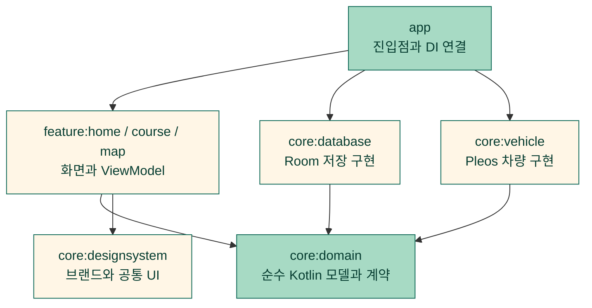

<div align="center">
  
  <h1>한길졸업</h1>
  <p><strong>내가 매일 가야 하는 길 하나부터, 내 힘으로.</strong></p>
  <p>생활 경로 연습을 준비하고 기록하는 Pleos 차량용 앱</p>
</div>

<br />

## 📄 목차

- [✍ 프로젝트 개요](#overview)
- [🚘 핵심 기능](#features)
- [⚙️ 기술 스택](#technology)
- [🏛️ 시스템 아키텍처](#architecture)
- [🔎 문제 해결](#problem-solving)
- [👤 개발자 소개](#developer)

<br />

<a id="overview"></a>

## ✍ 프로젝트 개요

운전이 익숙하지 않은 성인이 매일 가야 하는 길을 스스로 연습할 수 있도록 돕습니다.
주차 중에 목표와 코스를 준비하고, 연습의 시작과 마무리를 기록합니다.

| 항목 | 내용 |
|---|---|
| 개발 기간 | 2026.10.26 ~ 현재 |
| 구성 | 1인 개발 |
| 담당 | 기획, 디자인, Android 개발 |
| 출품 | Pleos 차량용 앱 공모전 출품 준비 중 |

<br />

<a id="features"></a>

## 🚘 핵심 기능

**목표 선택 → 코스와 과제 준비 → 연습 시작 → 마무리 기록 → 주차 후 메모**

실제 Pleos 에뮬레이터에서 동작을 확인한 앱 화면입니다. 코스와 과제는 고정 시연 내용입니다. 버튼을 누른 시각과 실제 SDK 차량 상태 관찰은 별도로 기록하며, 차량 상태는 활성 연습 중 앱 화면이 켜져 있을 때만 기록합니다. 위치와 실제 경로는 수집하지 않습니다. 사진을 누르면 원본 크기로 볼 수 있습니다.

| 홈과 연습 기록 | 목표 선택 |
|:---:|:---:|
| [](docs/images/screenshots/hangil-home.png) | [](docs/images/screenshots/hangil-goal.png) |

| 시연 코스 선택 | 오늘의 과제 |
|:---:|:---:|
| [](docs/images/screenshots/hangil-course.png) | [](docs/images/screenshots/hangil-task.png) |

| 생활권 코스의 시연 지점 | 교차로 코스의 시연 지점 |
|:---:|:---:|
| [](docs/images/screenshots/hangil-map-neighborhood.png) | [](docs/images/screenshots/hangil-map-intersections.png) |

지도 번호는 공개 장소의 고정 대표점입니다. 실제 이동 경로, 방문 순서나 차량 목적지를 뜻하지 않습니다.

| SDK 차량 상태 기록 | 주행 중 상세 조작 잠금 |
|:---:|:---:|
| [](docs/images/screenshots/hangil-recording.png) | [](docs/images/screenshots/hangil-driving-locked.png) |

| 주차 후 저장된 차량 기록 확인 |
|:---:|
| [](docs/images/screenshots/hangil-vehicle-review.png) |

| 메모 입력, 확대 글자와 다크 | 재실행 후 저장 메모 복원 |
|:---:|:---:|
| [](docs/images/screenshots/hangil-memo-input.png) | [](docs/images/screenshots/hangil-memo-restored.png) |

메모 화면의 문장은 동작 확인을 위해 직접 입력한 예시입니다. SDK 차량 기록과 별도로 저장하며, 주차와 UX 허용을 확인한 경우에만 열고 편집합니다.

| 기능 | 할 수 있는 일 |
|---|---|
| **목표와 코스 선택** | 생활 속 연습 목표를 고르고 두 가지 시연용 코스의 설명을 살펴봅니다. |
| **출발 전 브리핑과 오늘의 과제** | 선택한 코스의 확인 사항을 읽고 이번 연습에서 집중할 과제 하나를 정합니다. |
| **준비 내용 저장과 복원** | 목표, 코스와 과제를 기기에 저장하고 앱을 다시 열어 이어서 확인합니다. |
| **연습 시작과 마무리** | 시작과 종료 시각, 당시 코스와 과제를 저장하고 홈에서 최근 연습과 다음 행동을 확인합니다. |
| **활성 연습의 차량 상태 관찰** | 앱 화면이 켜진 동안 SDK가 전달한 기어, 방향지시등과 브레이크 상태를 세션에 기록합니다. 미확인, 미지원, 거부와 오류를 보존하고, 화면 이탈과 종료 뒤에는 수집하지 않습니다. |
| **주차 후 차량 기록 확인** | 최근 종료 세션의 저장된 SDK 관찰을 한 번에 하나씩 확인합니다. 당시 기어, 방향지시등과 브레이크, 연결과 앱 관찰 시각을 보고 이전/다음으로 저장 순서를 따라갑니다. |
| **주차 후 사용자 메모** | 최근 마무리한 연습에 짧은 메모를 직접 입력하고 저장, 수정, 명시적으로 지웁니다. 저장 내용은 앱을 다시 열어도 복원하며 미저장 초안과 구분합니다. |
| **코스별 시연 지도** | 준비한 코스에 맞춰 서울 시청 또는 광화문 주변의 공개 장소 세 곳을 번호로 표시합니다. 시연 출처와 지도 출처를 구분하고 실제 이동 경로나 현재 위치로 표현하지 않습니다. |
| **주행 중 상세 조작 잠금** | 주차와 UX 허용을 모두 확인해야 상세 조작을 허용합니다. 주행이나 상태 미확인에서는 준비 화면과 지도 조작을 잠급니다. |

<br />

<a id="technology"></a>

## ⚙️ 기술 스택

| 영역 | 기술 |
|---|---|
| 언어 | Kotlin 2.2.21 |
| 화면 | Jetpack Compose, Material 3 |
| 상태와 비동기 | ViewModel, Coroutines 1.10.2, StateFlow |
| 의존성 주입 | Hilt 2.57.2 |
| 로컬 저장 | Room 2.8.5, SQLite |
| 차량 상태 | Pleos Vehicle SDK 2.3.2 |
| 지도 표시 | MapLibre Android 13.5.0 |
| 빌드 구성 | Gradle Kotlin DSL, Version Catalog, convention plugin |

<br />

<a id="architecture"></a>

## 🏛️ 시스템 아키텍처

화면은 domain 계약을 사용하고, 차량 SDK와 저장 구현은 각각의 어댑터 모듈에 둡니다.
`app`은 진입점과 의존성 연결을 담당합니다.



<br />

<a id="problem-solving"></a>

## 🔎 문제 해결

상태 경합과 데이터 보존 문제를 해결한 실제 구현 사례 4개입니다.

### 1. 화면 갱신보다 먼저 도착한 주행 상태로 상세 조작 차단

**문제**

주차 중 표시한 버튼이 화면에 남아 있는 순간 D 상태가 도착하면, UI 갱신 전에 눌린 상세 조작이 실행될 수 있습니다. UX 제한 해제만으로 주차를 추정해도 같은 문제가 생깁니다.

**원인**

차량 기어와 UX 제한은 서로 다른 상태 스트림입니다. 화면이 마지막으로 조합한 P 상태와 실제 차량 스트림의 최신 D 상태가 잠시 다를 수 있어 버튼의 활성 상태만으로 실행을 허용할 수 없었습니다.

**해결**

주차 확인과 UX 제한 해제를 모두 요구하는 판정을 domain에 두었습니다. 화면 표시뿐 아니라 실제 처리 직전에도 차량과 제한 스트림의 현재 값을 함께 읽어 같은 판정을 적용합니다. 연결 끊김, 권한 거부와 미확인 상태는 잠금을 유지합니다.

**결과**

화면이 이전 주차 상태를 표시하더라도 처리 시점의 최신 차량 상태가 주행이면 로딩 시작, 재시도와 렌더 완료를 차단합니다. 주차와 UX 허용을 모두 확인해야 상세 조작을 진행합니다.

**대체안/회고**

버튼 비활성화만으로 해결하면 화면 갱신과 처리 사이의 틈이 남습니다. 두 스트림을 한 번 조합한 결과만 읽는 방법도 최신 기어를 놓칠 수 있어 처리 경계에서 다시 확인했습니다. 앱의 상세 조작을 제한하는 로직이며 차량 조향이나 제동을 제어하지 않습니다.

**코드**

[주차와 UX 조건을 함께 판단하는 상태](core/domain/src/main/kotlin/io/github/hangillab/hangil/core/domain/DrivingRestrictions.kt#L3-L9)

```kotlin
data class DrivingRestrictions(
    val parkingState: ParkingState = ParkingState.UNKNOWN,
    val uxRestrictionState: UxRestrictionState = UxRestrictionState.UNKNOWN,
) {
    val allowsDetailedInteraction: Boolean
        get() = parkingState == ParkingState.PARKED && uxRestrictionState == UxRestrictionState.UNRESTRICTED
}
```

[최신 차량 상태와 제한 상태 재확인](core/domain/src/main/kotlin/io/github/hangillab/hangil/core/domain/PracticeInteraction.kt#L4-L9)

```kotlin
fun allowsPracticeInteraction(
    vehicle: VehicleState,
    restrictions: DrivingRestrictions,
): Boolean =
    restrictions.allowsDetailedInteraction &&
        vehicle.toDrivingRestrictions(restrictions.uxRestrictionState).allowsDetailedInteraction
```

[지도 처리 직전의 reader, 조회 세대와 최신 차량 상태 재확인](feature/map/src/main/kotlin/io/github/hangillab/hangil/feature/map/MapViewModel.kt#L136-L143)

```kotlin
private fun canRender(attempt: MapRenderAttempt): Boolean {
    val owner = reader.get() ?: return false
    return owner.job.isActive && owner.id == attempt.reader && attempt.queryEpoch == queryEpoch.get() &&
        attempt.preparation is MapPreparationState.Ready && allowsInteraction()
}

private fun allowsInteraction(): Boolean =
    allowsPracticeInteraction(vehicleGateway.state.value, restrictionsProvider.restrictions.value)
```

### 2. 저장 도중 잠금 전환과 중복 시작을 트랜잭션으로 처리

**문제**

연습 시작 요청이 겹치면 활성 연습이 중복될 수 있고, 저장 중 주행 상태로 바뀌면 금지된 기록이 남을 수 있습니다. 이후 준비 내용을 바꿨을 때 과거 연습의 표시 내용도 달라져서는 안 됩니다.

**원인**

화면의 중복 클릭 방지는 동시 요청과 재실행을 보장하지 못합니다. 저장 전에만 조건을 검사하면 실제 쓰기가 끝날 때의 상태 변화도 놓칩니다. 과거 기록을 현재 코스 정보로 다시 해석하면 시작 당시 맥락이 사라집니다.

**해결**

Room 트랜잭션 안에서 허용 조건을 쓰기 전후로 검사하고, 두 번째 검사에서 잠기면 예외로 전체 쓰기를 롤백합니다. 활성 슬롯의 유일 인덱스로 저장소 수준에서도 한 개의 활성 연습만 허용합니다. 시작 당시 목표, 코스 버전, 과제와 표시명을 스냅샷으로 저장합니다.

**결과**

겹친 시작 요청에도 활성 연습은 하나만 남습니다. 저장 중 잠금으로 바뀐 요청은 롤백하고, 시작 당시의 코스와 과제는 이후 준비 내용 변경이나 DB 재열기에도 보존합니다.

**대체안/회고**

UI의 버튼 잠금이나 프로세스 내부 Mutex만으로는 DB에 직접 들어오는 중복 쓰기를 막지 못합니다. 트랜잭션과 유일 인덱스를 함께 사용했습니다. 비정상 시각과 저장 오류를 0초나 성공으로 보정하지 않고 명시적으로 구분해 원래 데이터를 보존했습니다.

**코드**

[시작 요청의 트랜잭션과 당시 준비 내용 저장](core/database/src/main/kotlin/io/github/hangillab/hangil/core/database/RoomPracticeSessionRepository.kt#L22-L64)

```kotlin
override suspend fun start(
    practice: PreparedPractice,
    startedAtEpochMillis: Long,
    canCommit: () -> Boolean,
): SessionStartResult {
    if (startedAtEpochMillis <= 0) return SessionStartResult.InvalidTime
    return try {
        database.withTransaction {
            requirePermission(canCommit)
            val active = database.practiceSessionDao().active()
            val prepared = catalog.resolve(database.preparationDao().current()?.selection()) as? Preparation.Ready
            val result =
                when {
                    active != null -> SessionStartResult.AlreadyActive(active.session())
                    prepared?.practice != practice -> SessionStartResult.PreparationChanged
                    else -> {
                        val entity =
                            PracticeSessionEntity(
                                sessionId = UUID.randomUUID().toString(),
                                goalId = practice.goal.id,
                                courseId = practice.course.id,
                                courseVersion = practice.course.version,
                                briefingVersion = practice.course.briefingVersion,
                                taskId = practice.task.id,
                                goalTitle = practice.goal.title,
                                courseTitle = practice.course.title,
                                taskTitle = practice.task.title,
                                courseReviewStatus = practice.course.reviewStatus.name,
                                startedAtEpochMillis = startedAtEpochMillis,
                                endedAtEpochMillis = null,
                                activeSlot = 1,
                            )
                        database.practiceSessionDao().insert(entity)
                        SessionStartResult.Started(entity.session())
                    }
                }
            requirePermission(canCommit)
            result
        }
    } catch (_: WriteBlocked) {
        SessionStartResult.Blocked
    }
}
```

[쓰기 전후 호출하는 허용 조건 검사](core/database/src/main/kotlin/io/github/hangillab/hangil/core/database/RoomPracticeSessionRepository.kt#L96-L100)

```kotlin
private fun requirePermission(canCommit: () -> Boolean) {
    if (!canCommit()) throw WriteBlocked()
}

private class WriteBlocked : RuntimeException()
```

[활성 연습 중복을 막는 유일 인덱스 선언 발췌](core/database/src/main/kotlin/io/github/hangillab/hangil/core/database/PracticeSessionEntity.kt#L10-L13)

```kotlin
@Entity(
    tableName = "practice_session",
    indices = [Index(value = ["sessionId"], unique = true), Index(value = ["activeSlot"], unique = true)],
)
```

### 3. 선택이 바뀐 지도에 이전 조회와 View의 완료가 섞이는 문제 해결

**문제**

코스 선택이 바뀌거나 준비 조회를 재시도한 뒤 이전 결과가 도착하면 새 지도 대신 지난 코스를 정상으로 표시할 수 있습니다. 같은 시도의 MapView가 재생성되거나 오류 뒤 완료 콜백이 늦게 도착하는 경우도 구분해야 합니다.

**원인**

조회 취소와 화면 재조합은 준비 결과의 전달, MapView의 렌더 콜백과 동시에 끝나지 않습니다. 재시도 번호만으로는 현재 조회를 소유한 화면과 같은 시도에서 새로 만든 View를 식별할 수 없고, 버퍼 앞에서만 세대를 검사하면 이미 전달 중인 결과가 재시도의 로딩 상태를 덮을 수 있습니다.

**해결**

다른 선택을 수신하면 카탈로그 해석 전에 기존 지도를 LOADING으로 무효화합니다. 준비 상태와 렌더 식별자를 함께 원자적으로 갱신하고, 반영 시점에 살아 있는 reader와 조회 세대를 다시 검사합니다. 렌더 완료는 최신 주차/UX 허용, 현재 시도와 View 토큰, LOADING 상태가 모두 맞을 때만 받아들입니다.

**결과**

수신한 선택 변경과 명시적 재조회 이후 이전 조회나 View의 결과가 현재 지도를 정상으로 만들지 못하게 했습니다. 오류 뒤 늦은 완료도 실패 상태를 덮지 않습니다. 이 경계는 앱이 수신한 준비 결과에 적용하며 Room이 아직 방출하지 않은 변경까지 즉시 감지한다고 보장하지 않습니다.

**대체안/회고**

flatMapLatest의 취소만 믿으면 이미 전달 중인 결과가 남을 수 있어 조회 세대와 반영 직전 검사를 함께 사용했습니다. 준비와 렌더를 별도로 갱신하는 대신 하나의 상태에 묶어 새 시도에 지난 코스가 섞이지 않게 했습니다. 스타일 수신은 화면 완성이 아니므로 실제 렌더 완료를 구분하며, 고정 시연 지점을 실제 주행 경로나 길안내로 해석하지 않습니다.

**코드**

[수신 선택을 먼저 무효화한 뒤 해석하는 준비 스트림 발췌](feature/map/src/main/kotlin/io/github/hangillab/hangil/feature/map/MapViewModel.kt#L215-L219)

```kotlin
flow { emitAll(repository.observeSelection()) }
    .map { selection ->
        invalidateReceivedSelection(owner, epoch, selection)
        resolve(selection)
    }.onStart { emit(MapPreparationState.Loading) }
```

[준비와 렌더 식별자를 함께 갱신하는 반영 함수](feature/map/src/main/kotlin/io/github/hangillab/hangil/feature/map/MapViewModel.kt#L145-L168)

```kotlin
private fun publishPreparation(
    owner: Reader,
    state: MapPreparationState,
    epoch: Long,
) {
    if (reader.get() !== owner || !owner.job.isActive || queryEpoch.get() != epoch) return
    render.update {
        if (reader.get() !== owner || !owner.job.isActive || queryEpoch.get() != epoch) {
            it
        } else {
            val permitted =
                if (state is MapPreparationState.Ready && !allowsInteraction()) {
                    MapPreparationState.Locked
                } else {
                    state
                }
            if (it.reader == owner.id && it.queryEpoch == epoch && it.preparation == permitted) {
                it
            } else {
                MapRenderAttempt(it.id + 1, reader = owner.id, preparation = permitted, queryEpoch = epoch)
            }
        }
    }
}
```

[현재 View의 실제 완료만 받아들이는 렌더 처리](feature/map/src/main/kotlin/io/github/hangillab/hangil/feature/map/MapViewModel.kt#L96-L108)

```kotlin
fun onMapRendered(
    attempt: Int,
    token: Long,
) {
    if (token <= 0) return
    render.update {
        if (canRender(it) && it.id == attempt && it.token == token && it.load == MapLoadState.LOADING) {
            it.copy(load = MapLoadState.READY)
        } else {
            it
        }
    }
}
```

### 4. SQLite의 묵시적 변환이 손상된 차량 관찰 값을 정상 값으로 만드는 문제 차단

**문제**

관찰 기록의 브레이크 값에 REAL이나 TEXT가 저장되면 Room의 Long 읽기가 0이나 1로 축약할 수 있습니다. 이 값을 Boolean으로 바꾸면 손상 데이터가 정상적인 미입력/입력 기록처럼 보이게 됩니다.

**원인**

SQLite의 선언 자료형과 실제 저장 자료형은 같다고 보장되지 않습니다. Kotlin 모델에서 0/1과 enum만 검사하면 Room이 이미 변환한 뒤라 원래 REAL/TEXT였다는 증거를 잃습니다. 누락, 미지원, 권한 거부와 실제 false를 같은 기본값으로 처리해도 기록의 의미가 바뀝니다.

**해결**

조회 시 `typeof()`를 값과 함께 읽고 브레이크와 관찰 시각의 실제 저장 자료형을 먼저 검사합니다. 읽기 상태와 nullable 값을 함께 보존하며 출처, enum과 상태/값 조합이 잘못되면 정상 값으로 복원하지 않습니다. 세션과 관찰의 외래 키, 삽입 순서와 이전 스키마 마이그레이션도 저장소 경계에서 검증합니다.

**결과**

묵시적 변환으로 정상 값처럼 보일 수 있는 손상 자료를 복원 오류로 구분합니다. 이전 스키마의 기록은 보존하면서 새 관찰 저장 경계를 추가했습니다.

**대체안/회고**

Long을 읽은 뒤 0/1만 검사하는 방법은 이미 일어난 묵시적 변환을 감지할 수 없어 물리 자료형 검사를 선택했습니다. 잘못된 행을 건너뛰거나 미확인을 0으로 바꾸는 대안은 기록 누락을 숨깁니다. 손상은 명시적인 오류로 전달하며 정상 기록과 구분합니다. 전면 앱의 SDK 수집 연결은 별도 기능으로 구현했으며, 이 사례는 저장 무결성 경계에 해당합니다. 내비 전환 중 지속 수집과 복습은 후속입니다.

**코드**

[값과 원래 SQLite 자료형을 함께 조회](core/database/src/main/kotlin/io/github/hangillab/hangil/core/database/VehicleObservationDao.kt#L8-L19)

```kotlin
@Dao
internal interface VehicleObservationDao {
    @Query(
        "SELECT vehicle_observation.*, typeof(brakeValue) AS brakeStorageType, " +
            "typeof(observedAtEpochMillis) AS observedTimeStorageType " +
            "FROM vehicle_observation WHERE sessionId = :sessionId ORDER BY id ASC",
    )
    fun observe(sessionId: String): Flow<List<VehicleObservationRow>>

    @Insert
    suspend fun insert(entity: VehicleObservationEntity): Long
}
```

[실제 자료형 확인 뒤 관찰값 복원](core/database/src/main/kotlin/io/github/hangillab/hangil/core/database/VehicleObservationRow.kt#L7-L17)

```kotlin
internal data class VehicleObservationRow(
    @Embedded val entity: VehicleObservationEntity,
    val brakeStorageType: String,
    val observedTimeStorageType: String,
) {
    fun observation(): SessionVehicleObservation {
        check(observedTimeStorageType == "integer") { "Invalid observation time storage type" }
        check(brakeStorageType == if (entity.brakeValue == null) "null" else "integer") { "Invalid brake value storage type" }
        return entity.observation()
    }
}
```

<br />

<a id="developer"></a>

## 👤 개발자 소개

| 개발자 | 담당 |
|---|---|
| [오인성](https://github.com/ois0886) | 기획, 디자인, Kotlin과 Compose 기반 Android 개발 |
