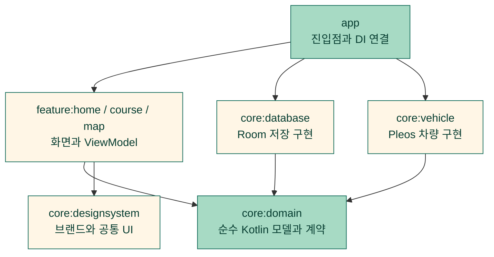

<div align="center">
  
  <h1>한길졸업</h1>
  <p><strong>내가 매일 가야 하는 길 하나부터, 내 힘으로.</strong></p>
  <p>생활 경로 연습을 준비하고 기록하는 Pleos 차량용 앱</p>
</div>

<br />

## 📄 목차

- [✍ 프로젝트 개요](#overview)
- [🚘 핵심 기능](#features)
- [⚙️ 기술 스택](#technology)
- [🏛️ 시스템 아키텍처](#architecture)
- [🔎 문제 해결](#problem-solving)
- [👤 개발자 소개](#developer)

<br />

<a id="overview"></a>

## ✍ 프로젝트 개요

운전이 익숙하지 않은 성인이 매일 가야 하는 길을 스스로 연습할 수 있도록 돕습니다.
주차 중에 목표와 코스를 준비하고, 연습의 시작과 마무리를 기록합니다.

| 항목 | 내용 |
|---|---|
| 개발 기간 | 2026.10.26 ~ 현재 |
| 구성 | 1인 개발 |
| 담당 | 기획, 디자인, Android 개발 |
| 출품 | Pleos 차량용 앱 공모전 출품 준비 중 |

<br />

<a id="features"></a>

## 🚘 핵심 기능

**목표 선택 → 코스와 과제 준비 → 연습 시작 → 마무리 기록**

실제 Pleos 에뮬레이터에서 동작을 확인한 앱 화면입니다. 코스와 과제는 고정 시연 내용이며, 연습 기록은 시작/종료 버튼을 누른 시각의 앱 기록입니다. 사진을 누르면 원본 크기로 볼 수 있습니다.

| 홈과 연습 기록 | 목표 선택 |
|:---:|:---:|
| [](docs/images/screenshots/hangil-home.png) | [](docs/images/screenshots/hangil-goal.png) |

| 시연 코스 선택 | 오늘의 과제 |
|:---:|:---:|
| [](docs/images/screenshots/hangil-course.png) | [](docs/images/screenshots/hangil-task.png) |

| 기능 | 할 수 있는 일 |
|---|---|
| **목표와 코스 선택** | 생활 속 연습 목표를 고르고 두 가지 시연용 코스의 설명을 살펴봅니다. |
| **출발 전 브리핑과 오늘의 과제** | 선택한 코스의 확인 사항을 읽고 이번 연습에서 집중할 과제 하나를 정합니다. |
| **준비 내용 저장과 복원** | 목표, 코스와 과제를 기기에 저장하고 앱을 다시 열어 이어서 확인합니다. |
| **연습 시작과 마무리** | 시작과 종료 시각, 당시 코스와 과제를 저장하고 홈에서 최근 연습과 다음 행동을 확인합니다. |
| **시연 지역 지도** | 서울 시청 주변의 고정 시연 지역을 지도에서 확인하고 시연 표시와 지도 출처를 제공합니다. |
| **주행 중 상세 조작 잠금** | 주차와 UX 허용을 모두 확인해야 상세 조작을 허용합니다. 주행이나 상태 미확인에서는 준비 화면과 지도 조작을 잠급니다. |

<br />

<a id="technology"></a>

## ⚙️ 기술 스택

| 영역 | 기술 |
|---|---|
| 언어 | Kotlin 2.2.21 |
| 화면 | Jetpack Compose, Material 3 |
| 상태와 비동기 | ViewModel, Coroutines 1.10.2, StateFlow |
| 의존성 주입 | Hilt 2.57.2 |
| 로컬 저장 | Room 2.8.5, SQLite |
| 차량 상태 | Pleos Vehicle SDK 2.3.2 |
| 지도 표시 | MapLibre Android 13.5.0 |
| 빌드 구성 | Gradle Kotlin DSL, Version Catalog, convention plugin |

<br />

<a id="architecture"></a>

## 🏛️ 시스템 아키텍처

화면은 domain 계약을 사용하고, 차량 SDK와 저장 구현은 각각의 어댑터 모듈에 둡니다.
`app`은 진입점과 의존성 연결을 담당합니다.



<br />

<a id="problem-solving"></a>

## 🔎 문제 해결

상태 경합과 데이터 보존 문제를 해결한 실제 구현 사례 4개입니다.
현재 같은 조건의 변경 전후 성능 측정은 없어 속도, 메모리나 성능 개선율을 주장하지 않습니다.
테스트 개수와 저장 행 수는 각 사례의 보조 회귀 근거로 구분했습니다.

<details>
<summary>검증 기준과 근거 확인</summary>

공개 검증 기준은 [구현 커밋 bfbc7df](https://github.com/HanGilLab/Android/commit/bfbc7dfd9f3bec2e841e1e76df080e720da71548)의 [CI 테스트 결과](https://github.com/HanGilLab/Android/actions/runs/40872083521)와 각 사례에 연결한 테스트 입력입니다.
JDK 17의 JVM/Robolectric 테스트에서 제어한 입력과 저장 결과이며 실차 운행 성과를 의미하지 않습니다.
[사례별 근거 집계 도구](scripts/summarize-case-evidence.py)는 기존 JUnit 보고서의 테스트 수, 실패, 오류, 건너뜀과 보고 시각을 집계합니다.
새 실행 여부는 보고 시각과 해당 커밋의 CI를 함께 확인해야 합니다.

</details>

### 1. 화면 갱신보다 먼저 도착한 주행 상태로 상세 조작 차단

**문제**

주차 중 표시한 버튼이 화면에 남아 있는 순간 D 상태가 도착하면, UI 갱신 전에 눌린 상세 조작이 실행될 수 있습니다. UX 제한 해제만으로 주차를 추정해도 같은 문제가 생깁니다.

**원인**

차량 기어와 UX 제한은 서로 다른 상태 스트림입니다. 화면이 마지막으로 조합한 P 상태와 실제 차량 스트림의 최신 D 상태가 잠시 다를 수 있어 버튼의 활성 상태만으로 실행을 허용할 수 없었습니다.

**해결**

주차 확인과 UX 제한 해제를 모두 요구하는 판정을 domain에 두었습니다. 화면 표시뿐 아니라 실제 처리 직전에도 차량과 제한 스트림의 현재 값을 함께 읽어 같은 판정을 적용합니다. 연결 끊김, 권한 거부와 미확인 상태는 잠금을 유지합니다.

**결과**

화면이 이전 주차 상태를 표시하더라도 처리 시점의 최신 차량 상태가 주행이면 로딩 시작, 재시도와 렌더 완료를 차단합니다. 주차와 UX 허용을 모두 확인해야 상세 조작을 진행합니다.

<details>
<summary>회귀 검증 근거</summary>

[상태 조합 테스트](core/domain/src/test/kotlin/io/github/hangillab/hangil/core/domain/DrivingRestrictionsTest.kt)는 주차 3종 × UX 3종의 9개 조합 중 P 확인과 UX 해제인 1개만 허용하고 나머지 8개를 차단합니다. [최신 D 경합 회귀](feature/map/src/test/kotlin/io/github/hangillab/hangil/feature/map/MapViewModelTest.kt)는 UI 조합을 진행하기 전에 D를 넣어 로딩 시작, 재시도와 렌더 완료가 허용되지 않는지 확인합니다. 상태 판정 테스트 2개와 지도 경계 테스트 5개가 통과했고 실패, 오류, 건너뜀은 각각 0개입니다.

</details>

**대체안/회고**

버튼 비활성화만으로 해결하면 화면 갱신과 처리 사이의 틈이 남습니다. 두 스트림을 한 번 조합한 결과만 읽는 방법도 최신 기어를 놓칠 수 있어 처리 경계에서 다시 확인했습니다. 앱의 상세 조작을 제한하는 로직이며 차량 조향이나 제동을 제어하지 않습니다.

**코드**

<details>
<summary>핵심 구현 보기</summary>

[실제 판정 함수](core/domain/src/main/kotlin/io/github/hangillab/hangil/core/domain/PracticeInteraction.kt):

```kotlin
fun allowsPracticeInteraction(
    vehicle: VehicleState,
    restrictions: DrivingRestrictions,
): Boolean =
    restrictions.allowsDetailedInteraction &&
        vehicle.toDrivingRestrictions(restrictions.uxRestrictionState).allowsDetailedInteraction
```

</details>

### 2. 저장 도중 잠금 전환과 중복 시작을 트랜잭션으로 처리

**문제**

연습 시작 요청이 겹치면 활성 연습이 중복될 수 있고, 저장 중 주행 상태로 바뀌면 금지된 기록이 남을 수 있습니다. 이후 준비 내용을 바꿨을 때 과거 연습의 표시 내용도 달라져서는 안 됩니다.

**원인**

화면의 중복 클릭 방지는 동시 요청과 재실행을 보장하지 못합니다. 저장 전에만 조건을 검사하면 실제 쓰기가 끝날 때의 상태 변화도 놓칩니다. 과거 기록을 현재 코스 정보로 다시 해석하면 시작 당시 맥락이 사라집니다.

**해결**

Room 트랜잭션 안에서 허용 조건을 쓰기 전후로 검사하고, 두 번째 검사에서 잠기면 예외로 전체 쓰기를 롤백합니다. 활성 슬롯의 유일 인덱스로 저장소 수준에서도 한 개의 활성 연습만 허용합니다. 시작 당시 목표, 코스 버전, 과제와 표시명을 스냅샷으로 저장합니다.

**결과**

겹친 시작 요청에도 활성 연습은 하나만 남습니다. 저장 중 잠금으로 바뀐 요청은 롤백하고, 시작 당시의 코스와 과제는 이후 준비 내용 변경이나 DB 재열기에도 보존합니다.

<details>
<summary>회귀 검증 근거</summary>

[저장소 회귀 테스트 11개](core/database/src/test/kotlin/io/github/hangillab/hangil/core/database/RoomPracticeSessionRepositoryTest.kt)가 통과했고 실패, 오류, 건너뜀은 각각 0개입니다. 이 중 동시 시작 4개 요청은 시작 1개, 이미 활성 상태 3개로 끝나며 활성 행은 1개입니다. 시작의 두 번째 조건 검사에서 잠기면 새 세션은 0행, 종료 중 잠기면 기존 활성 세션 1행이 그대로 남습니다. 준비 변경과 DB 재열기 후에도 당시 스냅샷이 동일한지 비교합니다.

</details>

**대체안/회고**

UI의 버튼 잠금이나 프로세스 내부 Mutex만으로는 DB에 직접 들어오는 중복 쓰기를 막지 못합니다. 트랜잭션과 유일 인덱스를 함께 사용했습니다. 비정상 시각과 저장 오류를 0초나 성공으로 보정하지 않고 명시적으로 구분해 원래 데이터를 보존했습니다.

**코드**

<details>
<summary>핵심 구현 보기</summary>

[실제 종료 처리의 트랜잭션 경계](core/database/src/main/kotlin/io/github/hangillab/hangil/core/database/RoomPracticeSessionRepository.kt)에서 발췌했습니다. 생략한 부분은 세션 조회와 결과별 쓰기입니다.

```kotlin
database.withTransaction {
    requirePermission(canCommit)
    // 세션 조회와 결과별 쓰기
    requirePermission(canCommit)
    result
}
```

</details>

### 3. 재생성된 지도에 이전 View의 완료 콜백이 섞이는 문제 해결

**문제**

지도 재시도나 화면 재생성 뒤 이전 MapView의 완료 콜백이 도착하면 현재 지도를 잘못 READY로 표시할 수 있습니다. 오류 뒤 늦은 완료 콜백이 오류 상태를 덮는 문제도 있습니다.

**원인**

재시도 번호만 비교하면 같은 시도 안에서 다시 생성된 서로 다른 MapView를 구분할 수 없습니다. 스타일 로딩 완료 역시 실제 화면 렌더 완료와 다릅니다.

**해결**

재시도 번호와 View별 토큰을 함께 비교합니다. 최신 조작 허용 조건, 현재 시도와 토큰, LOADING 상태가 모두 맞을 때만 READY로 전환합니다. 실패한 지도는 명시적 재시도에서 새 시도를 만들며, 오래된 View의 성공과 오류 콜백을 무시합니다.

**결과**

현재 시도의 현재 View가 실제 렌더를 마쳤을 때만 READY로 전환합니다. 이전 View의 완료와 재시도 전의 성공/오류가 현재 지도나 실패 상태를 덮어쓰지 못하게 했습니다.

<details>
<summary>회귀 검증 근거</summary>

[MapViewModel 회귀 테스트 5개](feature/map/src/test/kotlin/io/github/hangillab/hangil/feature/map/MapViewModelTest.kt)가 통과했고 실패, 오류, 건너뜀은 각각 0개입니다. 같은 시도의 View를 2번 생성한 뒤 이전 토큰의 완료를 넣어도 LOADING이 유지되고, 현재 토큰의 완료에만 READY가 됩니다. 실패 후 같은 시도의 늦은 완료는 FAILED를 유지하고, 재시도 후 이전 시도의 성공과 오류도 상태를 바꾸지 않습니다.

</details>

**대체안/회고**

재시도 번호만으로는 View 재생성 경계를 표현할 수 없어 View 토큰을 추가했습니다. 스타일 수신 시점을 성공으로 처리하는 대안은 타일과 글꼴 오류를 놓칠 수 있어 실제 렌더 완료를 기준으로 삼았습니다. 현재 지도는 고정 시연 지역 표시이며 위치 추적이나 자체 내비 완성으로 표현하지 않습니다.

**코드**

<details>
<summary>핵심 구현 보기</summary>

[실제 렌더 완료 처리](feature/map/src/main/kotlin/io/github/hangillab/hangil/feature/map/MapViewModel.kt):

```kotlin
fun onMapRendered(
    attempt: Int,
    token: Long,
) {
    if (!allowsInteraction()) return
    render.update {
        if (it.id == attempt && it.token == token && it.load == MapLoadState.LOADING) it.copy(load = MapLoadState.READY) else it
    }
}
```

</details>

### 4. SQLite의 묵시적 변환이 손상된 차량 관찰 값을 정상 값으로 만드는 문제 차단

**문제**

관찰 기록의 브레이크 값에 REAL이나 TEXT가 저장되면 Room의 Long 읽기가 0이나 1로 축약할 수 있습니다. 이 값을 Boolean으로 바꾸면 손상 데이터가 정상적인 미입력/입력 기록처럼 보이게 됩니다.

**원인**

SQLite의 선언 자료형과 실제 저장 자료형은 같다고 보장되지 않습니다. Kotlin 모델에서 0/1과 enum만 검사하면 Room이 이미 변환한 뒤라 원래 REAL/TEXT였다는 증거를 잃습니다. 누락, 미지원, 권한 거부와 실제 false를 같은 기본값으로 처리해도 기록의 의미가 바뀝니다.

**해결**

조회 시 `typeof()`를 값과 함께 읽고 브레이크와 관찰 시각의 실제 저장 자료형을 먼저 검사합니다. 읽기 상태와 nullable 값을 함께 보존하며 출처, enum과 상태/값 조합이 잘못되면 정상 값으로 복원하지 않습니다. 세션과 관찰의 외래 키, 삽입 순서와 이전 스키마 마이그레이션도 저장소 경계에서 검증합니다.

**결과**

묵시적 변환으로 정상 값처럼 보일 수 있는 손상 자료를 복원 오류로 구분합니다. 이전 스키마의 기록은 보존하면서 새 관찰 저장 경계를 추가했습니다.

<details>
<summary>회귀 검증 근거</summary>

[관찰 저장소 11개](core/database/src/test/kotlin/io/github/hangillab/hangil/core/database/RoomVehicleObservationRepositoryTest.kt)와 [마이그레이션 2개](core/database/src/test/kotlin/io/github/hangillab/hangil/core/database/VehicleObservationMigrationTest.kt)가 통과했고 실패, 오류, 건너뜀은 각각 0개입니다. 논리 손상 변형 16개와 실제 SQL로 넣은 자료형 손상 4개는 모두 복원 오류가 됩니다. 자료형 입력은 브레이크 REAL 2개/TEXT 1개와 관찰 시각 REAL 1개입니다. v2→v3와 v1→v2→v3의 기존 필드 보존 및 새 관찰 0행도 확인합니다. 검증 데이터로 확인한 저장 기반이며 제품의 실제 SDK 관찰 수집기는 아직 연결하지 않았습니다.

</details>

**대체안/회고**

Long을 읽은 뒤 0/1만 검사하는 방법은 이미 일어난 묵시적 변환을 감지할 수 없어 물리 자료형 검사를 선택했습니다. 잘못된 행을 건너뛰거나 미확인을 0으로 바꾸는 대안은 기록 누락을 숨깁니다. 손상은 명시적인 오류로 전달하며 정상 기록과 구분합니다. 수집기 연결과 실제 SDK 기록 검증은 별도 완료 조건으로 남습니다.

**코드**

<details>
<summary>핵심 구현 보기</summary>

[실제 행 복원 검사](core/database/src/main/kotlin/io/github/hangillab/hangil/core/database/VehicleObservationRow.kt)와 [물리 자료형 조회](core/database/src/main/kotlin/io/github/hangillab/hangil/core/database/VehicleObservationDao.kt):

```kotlin
fun observation(): SessionVehicleObservation {
    check(observedTimeStorageType == "integer") { "Invalid observation time storage type" }
    check(brakeStorageType == if (entity.brakeValue == null) "null" else "integer") { "Invalid brake value storage type" }
    return entity.observation()
}
```

</details>

<br />

<a id="developer"></a>

## 👤 개발자 소개

| 개발자 | 담당 |
|---|---|
| [오인성](https://github.com/ois0886) | 기획, 디자인, Kotlin과 Compose 기반 Android 개발 |
