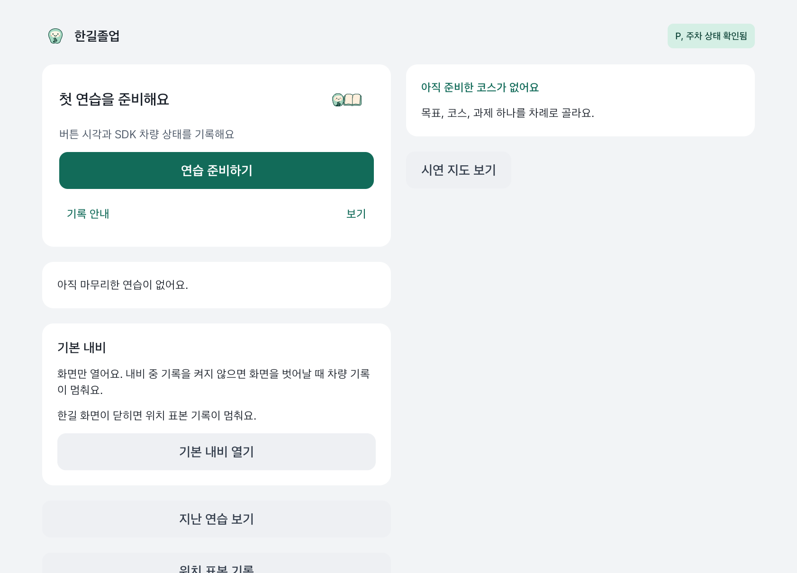
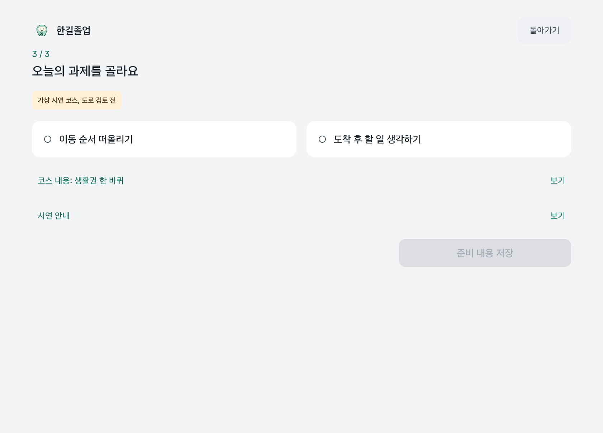
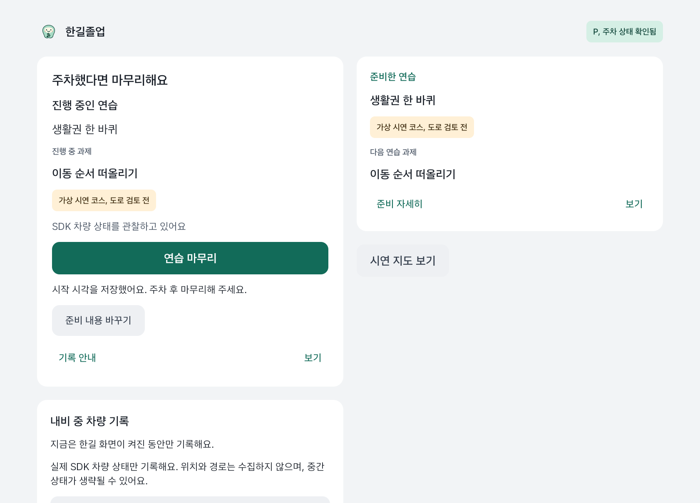
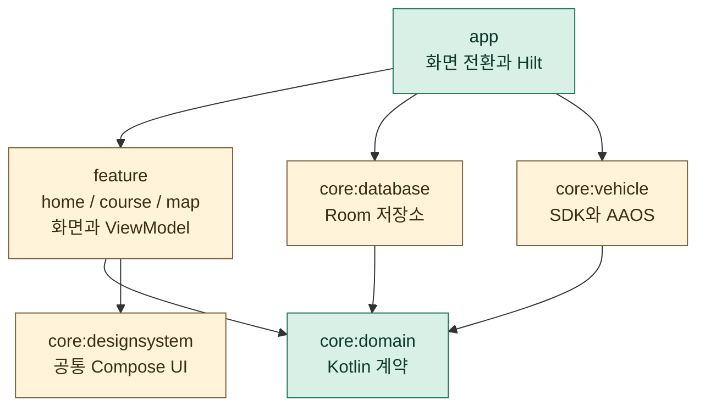

<div align="center">
  
  <h1>한길졸업</h1>
  <p><strong>내가 매일 가야 하는 길 하나부터, 내 힘으로.</strong></p>
  <p>생활 경로를 연습하는 Pleos 차량용 앱</p>
</div>

<br />

## 📄 목차

- [✍ 프로젝트 개요](#overview)
- [🚘 핵심 기능](#features)
- [⚙️ 기술 스택](#technology)
- [🏛️ 시스템 아키텍처](#architecture)
- [🔎 문제 해결](#problem-solving)
- [👤 개발자 소개](#developer)

<br />

<a id="overview"></a>

## ✍ 프로젝트 개요

운전이 오랜만인 면허 소지자가 자주 가는 길을 연습하는 앱입니다. 주차 중 목표와 과제를 정하고, 연습을 마치면 차량 기록과 메모를 보며 다음 과제를 고릅니다.

<a id="features"></a>

## 🚘 핵심 기능

| 홈 | 오늘의 과제 |
|:---:|:---:|
| [](docs/images/screenshots/pleos-home.png) | [](docs/images/screenshots/pleos-task.png) |

| 연습 중 | 연습 마무리 |
|:---:|:---:|
| [](docs/images/screenshots/pleos-recording.png) | [](docs/images/screenshots/pleos-practice-finished.png) |

| 저장된 차량 기록 | 다음 과제 저장 |
|:---:|:---:|
| [](docs/images/screenshots/pleos-vehicle-review.png) | [](docs/images/screenshots/pleos-next-practice-saved.png) |

- **준비** 목표, 코스, 과제를 저장합니다. 판교를 거쳐 양재까지 코스는 경유지와 도착지를 Pleos 기본 내비에 보낼 수 있습니다.
- **연습** 시작과 종료 시각, SDK가 전달한 기어, 방향지시등, 브레이크를 기록합니다. 위치 표본은 직접 켜면 한길 화면에서 기록합니다. 내비 사용 중에도 차량 상태를 기록하려면 별도로 켭니다.
- **복습** 지난 연습의 차량 기록과 위치 표본을 읽고 메모를 남깁니다. 공개 도로선을 복습 구간으로 골라 다음 과제와 함께 저장할 수 있습니다.
- **주차 확인** 기어 P와 화면 조작 허용을 모두 확인해야 준비, 복습과 상세 조작을 열 수 있습니다.

화면의 코스는 시연용입니다. 복습에서는 시연 코스, 저장된 SDK 관찰, 사용자가 남긴 메모의 출처를 각각 표시합니다.

<a id="technology"></a>

## ⚙️ 기술 스택

Kotlin, Jetpack Compose, Coroutines, Hilt, Room, MapLibre, Pleos Vehicle SDK, FusedLocation, NaviHelper

<a id="architecture"></a>

## 🏛️ 시스템 아키텍처



화살표는 주요 모듈 의존 방향입니다. `app`이 Hilt로 Room 저장소와 Pleos 어댑터를 연결하고, 화면의 ViewModel은 `core:domain` 계약을 사용합니다.

차량 어댑터가 읽은 기어와 AAOS 제한으로 상세 조작을 판정합니다. 복습을 열면 Room에서 선택한 종료 기록을 읽습니다. 차량 관찰과 메모는 각 영역을 펼칠 때, 위치 표본은 위치 기록 화면을 열 때 불러옵니다.

<a id="problem-solving"></a>

## 🔎 문제 해결

### 1. 앱을 다시 켰을 때 중단된 위치 기록 복구하기

**문제** 앱이 종료되면 이전 프로세스가 남긴 위치 기록을 중단 상태로 정리합니다. 연습 이력이 쌓일수록 이 복구가 오래 걸렸습니다.

**원인** 실행 목록을 읽은 뒤, 연습마다 같은 실행과 그 표본을 다시 조회했습니다. 여러 실행의 표본이 한 연습에 쌓이면 한 번에 읽는 행 수도 늘어났습니다.

**해결** 실행 목록은 한 번 읽고 표본은 저장 순서대로 512행씩 읽습니다. 페이지 사이에서도 실행별 직전 표본을 유지해 수신 시각과 순번을 확인합니다. 전체 검증을 통과하면 같은 트랜잭션에서 이전 프로세스가 남긴 열린 실행을 중단 처리합니다.

**결과** Pleos API 34 에뮬레이터의 debug 빌드에서 합성 연습 128개에 실행 두 개와 실행당 표본 32개를 저장했습니다. 복구 트랜잭션 중앙값은 131.97ms에서 92.73ms로 줄어 39.24ms(29.7%) 감소했고, p95는 162.10ms에서 115.12ms로 줄었습니다. 전후 APK를 번갈아 두 번씩 실행하고 각 실행에서 예열 10회 뒤 전후 각 80회를 측정했습니다. 손상된 표본을 발견하면 기존 실행과 표본을 그대로 보존합니다.

**대체안/회고** 열린 실행만 확인하면 보관된 기록의 손상을 놓칩니다. 전체 검증을 유지하고 중복 조회와 한 번에 불러오는 표본 수를 줄였습니다. 이 수치는 앱 시작 전체 시간 중 복구 트랜잭션에 해당합니다.

**코드**

```kotlin
var firstId = Long.MIN_VALUE
while (true) {
    val rows = dao.recoveryEvents(firstId, RECOVERY_PAGE_SIZE)
    for (row in rows) {
        val event = row.event()
        val byRun = checkNotNull(runsBySession[event.sessionId]) { "Foreign location source" }
        validateEvent(event, byRun, previousBySession.getOrPut(event.sessionId) { mutableMapOf() })
    }
    if (rows.size < RECOVERY_PAGE_SIZE) return
    val lastId = rows.last().entity.id
    if (lastId == Long.MAX_VALUE) return
    firstId = lastId + 1
}
```

### 2. 위치 표본이 쌓여도 저장 지연 줄이기

**문제** 연습 중 위치 표본을 추가할 때마다, 이미 저장한 표본이 많을수록 쓰기 트랜잭션이 오래 걸렸습니다.

**원인** 다음 순번과 직전 수신 시각을 결정하려고 같은 연습의 모든 표본을 Kotlin 객체로 변환하고, 실행별로 다시 묶었습니다.

**해결** 정상 형태의 기존 행은 SQL에서 자료형, 시간과 순번을 검사하고 현재 실행의 마지막 표본만 변환합니다. SQL에서 확정할 수 없는 행은 기존 전체 검증으로 넘깁니다. 다음 표본 추가와 커밋 직전 권한 확인은 같은 트랜잭션에서 합니다.

**결과** Pleos API 34 에뮬레이터의 debug 빌드에서 합성 표본이 1,023개인 실행에 다음 표본을 저장했습니다. 커밋까지 중앙값은 23.69ms에서 9.18ms로 줄어 14.51ms(61.3%) 감소했고, p95는 33.36ms에서 13.18ms로 줄었습니다. 전후 APK를 번갈아 두 번씩 실행하고, 매번 예열 10회 뒤 전후 각 80회를 측정했습니다.

**대체안/회고** 마지막 행만 읽으면 그보다 앞선 행의 손상이나 순번 누락을 놓칩니다. 기존 행은 계속 검사하되, 정상 표본을 매번 객체로 만들던 비용을 줄였습니다. 오류 메타데이터가 있어 전체 검증으로 돌아가는 입력은 이 측정에 포함하지 않았습니다.

**코드**

```kotlin
val runs = readRuns(sessionId)
return if (dao.needsEventDecoding(sessionId, LocationRecordingRepository.MAX_EVENTS_PER_RUN)) {
    readEvents(sessionId, runs).lastOrNull { it.runId == runId }
} else {
    dao.lastEvent(sessionId, runId)?.event()
}
```

### 3. 저장 위치가 많은 복습 지도 열기

**문제** 긴 연습 기록의 복습 지도를 열면 점, 수신 순서 선, 카메라 범위를 한꺼번에 계산해야 했습니다. 표본이 많을수록 지도 초기화와 화면 작업이 같은 스레드에서 시간을 나눠 썼습니다.

**원인** Compose에서 선 데이터를 만들고 MapLibre 스타일 콜백에서 점과 범위를 다시 준비했습니다. 처음에 계산을 별도 스레드로만 옮겼을 때는 지도가 그 결과를 기다려 작은 입력의 렌더링이 늦어졌습니다.

**해결** 저장 기록을 고정한 뒤 도형 준비와 지도 초기화를 동시에 시작합니다. 스타일에 레이어를 붙일 때는 메인 스레드에서 최신 주차 허용과 화면을 다시 확인합니다. 카메라와 레이어가 적용된 뒤 완전히 그려진 프레임에서만 준비를 완료합니다.

**결과** Pleos API 34 에뮬레이터의 debug 빌드, 로컬 배경, 합성 표본 1,024개에서 열기부터 첫 렌더 완료까지 중앙값이 255.74ms에서 166.78ms로 줄었습니다. 88.97ms(34.8%) 차이입니다. 메인 스레드 CPU 시간은 81.95ms에서 65.22ms로 16.73ms(20.4%) 줄었습니다. 전후 APK를 번갈아 두 번 실행하고 각 실행에서 예열 10회 뒤 전후 각 80회를 측정했습니다. 프레임 완료 시간의 사분위 범위는 겹쳤습니다.

**대체안/회고** 기존 MapView를 여러 복습 기록에 공유하면 이전 콜백을 정리해야 할 범위가 커집니다. 지도 수명은 화면에 묶어 두고 순수 계산만 분리했습니다. 원격 타일을 가져오는 시간은 이 결과에 포함되지 않습니다.

**코드**

```kotlin
val prepared = withContext(Dispatchers.Default) {
    StoredLocationMapGeometry.prepare(input, mapRoad, reviewRoad, preview != null)
}
if (suppliedLoad === load && load.value == MapLoadState.LOADING && mapPermitted()) {
    if (reviewRoad != null || input.courseRoads.isNotEmpty()) roadGeometry = prepared
    geometryResult.complete(prepared)
}
```

### 4. 복습과 차량 기록에 필요한 연습만 조회하기

**문제** 복습에서 지정한 연습 한 건을 확인하거나 전면 차량 기록을 시작할 때, 종료 이력이 쌓일수록 원본을 읽는 시간이 늘어났습니다.

**원인** Room에서 전체 연습 목록을 읽어 각 행의 저장 도로 JSON을 해석한 뒤, 화면과 기록 제어기가 필요한 행만 골랐습니다.

**해결** 복습은 기존 세션 ID 인덱스로 원본 한 건을 읽습니다. 전면 차량 기록은 종료 시각이나 활성 슬롯을 기준으로 활성 후보만 읽습니다. 손상된 원본이나 후보가 여러 개인 경우에는 읽기 오류를 전달합니다.

**결과** Pleos API 34 에뮬레이터의 debug 빌드에서 합성 도로를 가진 이전 연습 128개를 저장했습니다. 복습 원본의 첫 반환 중앙값은 93.36ms에서 8.07ms로 85.29ms(91.4%) 줄었고, p95는 128.51ms에서 11.78ms로 줄었습니다. 활성 연습의 첫 반환 중앙값은 96.46ms에서 8.03ms로 줄었습니다. 실행마다 예열 10회를 거쳐 전후 각 80회를 측정했습니다.

**대체안/회고** 전체 목록을 캐시에 두면 조회 범위는 그대로이고 원본 교체와 삭제 때 캐시를 맞춰야 합니다. 소비자별로 조회 범위를 줄였습니다. 활성 후보 조건은 SQLite에서 테이블을 훑을 수 있지만 Room은 해당 후보만 변환합니다. 수치는 저장소 첫 응답까지입니다.

**코드**

```kotlin
override fun observeSession(sessionId: String) =
    database.practiceSessionDao().observeSessionChecked(sessionId).map { it?.session() }

override fun observeActiveSession() =
    database.practiceSessionDao().observeUnfinishedChecked().map { rows ->
        check(rows.size <= 1) { "Invalid unfinished session ownership" }
        rows.singleOrNull()?.session()
    }
```

<a id="developer"></a>

## 👤 개발자 소개

2026년 10월부터 기획, 디자인, Android 개발을 혼자 맡았습니다.
