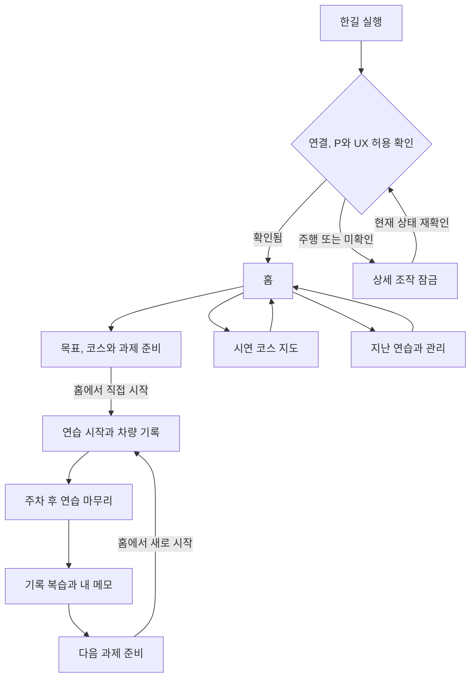
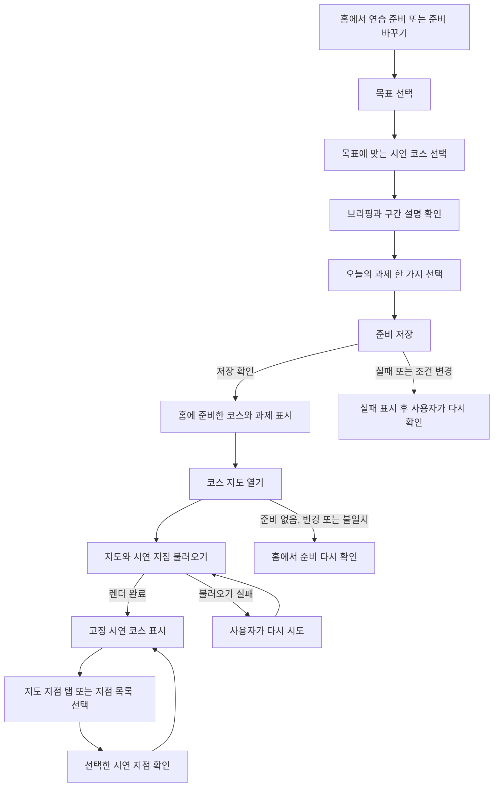
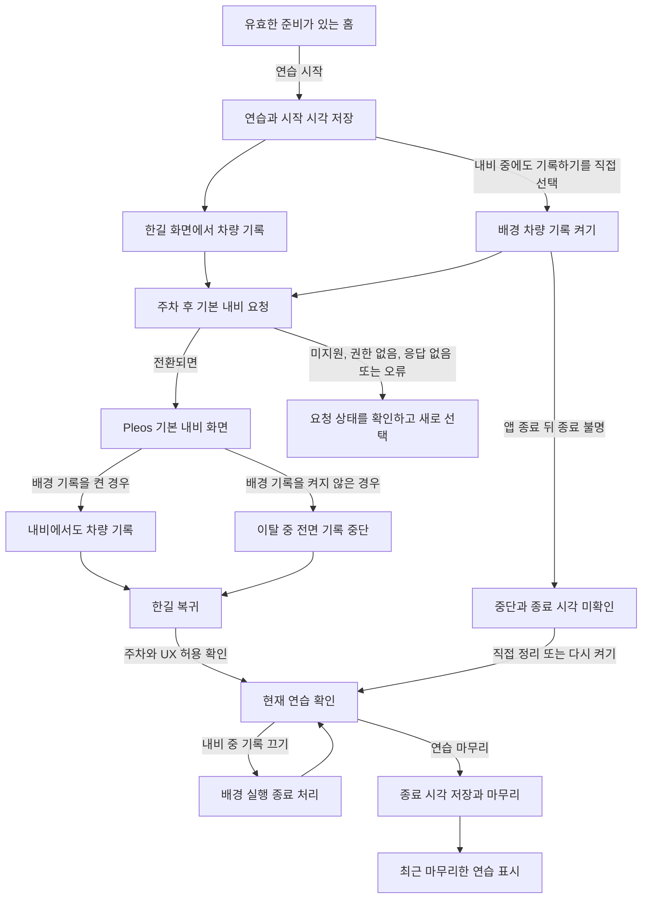
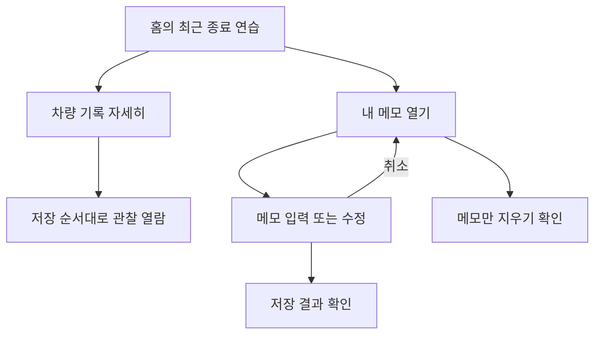
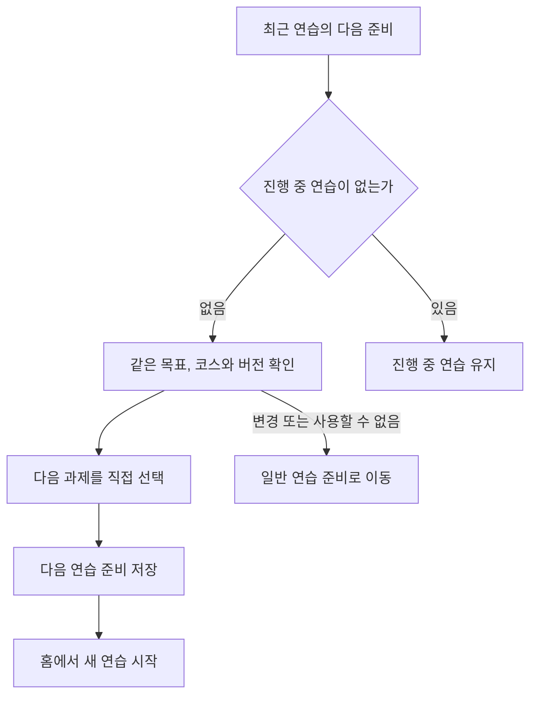
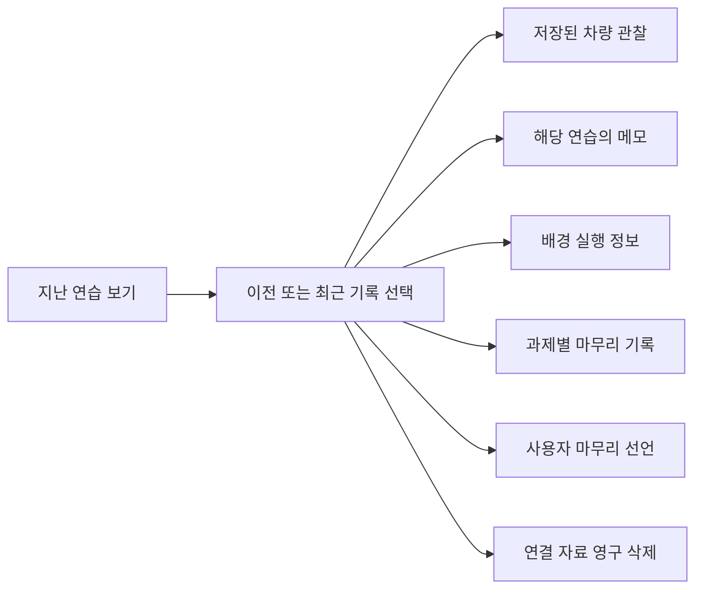
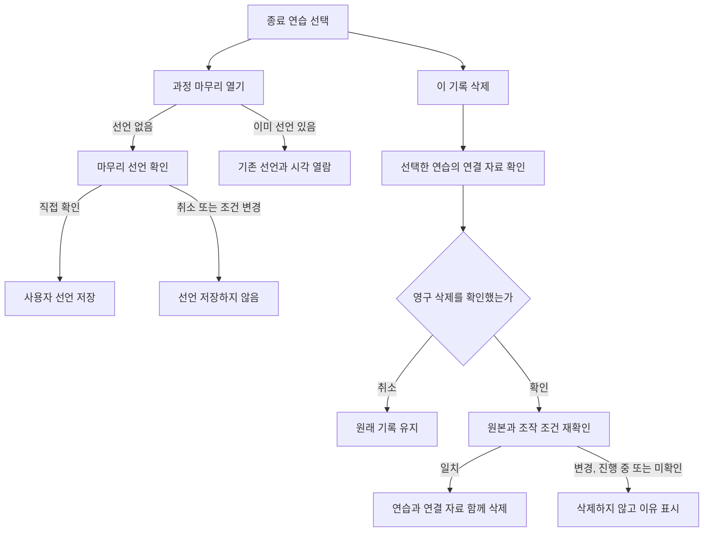
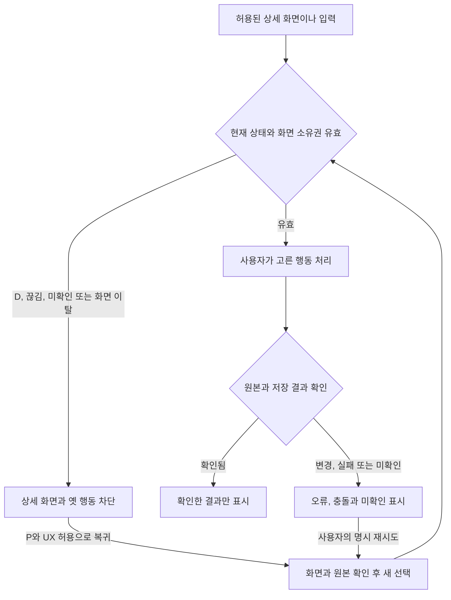
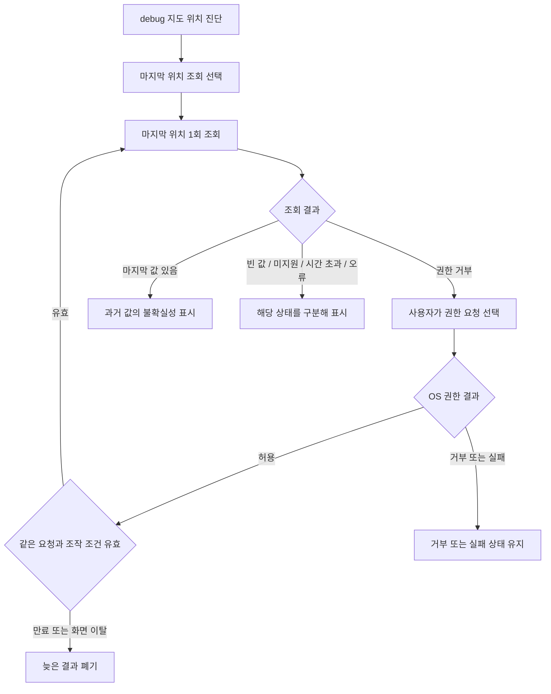
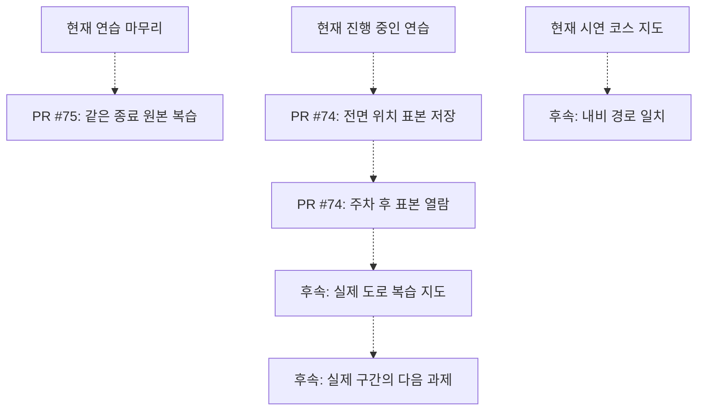

# 한길 앱 전체 사용 흐름

이 도식은 2026-11-02의 [main 기준 7ccfea6](https://github.com/HanGilLab/Android/commit/7ccfea6684e5b9b3dcad8364c96186af6bc251c8)의 화면 연결과 사용자 행동을 설명한다. 새 앱 실행이나 이번 실기 성공을 증명하는 화면은 아니다. 기본 내비, 실제 SDK 차량 관찰, 고정 시연 코스와 사용자 메모의 출처를 구분한다.

## 전체 동선

별도의 회원가입, 로그인이나 첫 실행 온보딩 화면은 현재 연결되어 있지 않다. 앱은 홈에서 시작한다. 준비와 지도, 지난 연습, 다음 연습은 별도 목적지이며 연습 시작/종료와 최근 기록, 기본 내비 요청은 홈 안의 행동이다.

## 준비와 지도

준비 저장은 연습 시작과 별개다. 지도 지점은 고정 시연 자료이며 실제 주행 경로, 현재 위치나 길안내 경로를 의미하지 않는다. 지도 조회 실패나 미확인 상태를 빈 정상 지도나 실제 경로로 바꾸지 않는다.

## 연습, 내비와 차량 기록

기본 내비 요청은 화면 열기만 요청하며 목적지, 경유지와 시연 코스를 전송하지 않는다. 요청 반환을 실제 화면 전환이나 길안내 성공으로 표시하지 않는다. 배경 기록은 차량 상태에 한하며 위치와 경로를 수집하지 않는다. 중간 상태와 앱이 종료된 동안의 수집은 보장하지 않는다.

주행 중에는 연습 마무리, 메모와 상세 복습을 조작할 수 없다. 상세 화면의 잠금과 이미 시작한 차량 기록 수집은 서로 다른 동작이다.

## 최근 연습, 지난 연습과 다음 준비

지난 연습 화면의 기존 메모 수정은 진행 중인 연습이 없어야 하며 현재 주차/UX 조건도 허용되어야 한다. 홈의 최근 메모는 같은 최신 종료 원본과 현재 주차/UX 조건을 확인하는 별도 편집 흐름이다. 빈 메모와 글자 수 제한, 원본 변경, 저장 충돌과 결과 미확인은 별도로 표시한다. 최근 메모만 지우기는 연습과 차량 기록을 삭제하지 않는다.

다음 연습은 최근 종료 연습을 바탕으로 같은 목표와 코스의 과제를 다시 고르는 준비 기능이다. 지난 임의 연습이나 실제 도로 구간에서 다음 과제로 바로 이어지는 기능으로 확대해 해석하지 않는다. 배경 실행 시각은 실제 연속 수집 기간을 증명하지 않는다.

## 과정 마무리와 삭제

과정 마무리는 선택한 연습에 대한 사용자의 선언이다. 자동 운전 능력 평가나 전역 과정의 이수 인증이 아니다. 영구 삭제는 확인한 연습과 연결 자료에 한정되며 삭제 성공 전에는 사라진 것으로 표시하지 않는다.

## 모든 상세 흐름에 적용되는 잠금과 실패

P로 돌아와도 이전 삭제 확인, 내비 요청이나 거부된 클릭을 자동 실행하지 않는다. 누락, 미지원과 오류를 0이나 정상 값으로 바꾸지 않는다.

## debug 전용 진단

일반 사용 흐름과 구분되는 debug 기능이다. 홈의 차량 진단에서 현재 연결과 SDK 상태를 확인하고, 지도의 위치 진단에서 마지막 알려진 위치를 명시적으로 조회한다. 권한이 없으면 별도 권한 요청을 사용자가 선택할 수 있다.

이 진단은 연속 위치 수집이나 주행 경로 저장 기능이 아니다. 이번 도식 작성 중에는 앱 실행, 권한 요청과 위치 조회를 수행하지 않았다.

## 아직 main에 없는 연결

아래 점선은 검토 중이거나 후속 구현이 필요한 연결이다. 위의 현재 사용 흐름과 별도로 읽는다. PR의 구현 존재, CI/리뷰와 실제 수동 검증 완료는 각각 구분한다.

[PR #74](https://github.com/HanGilLab/Android/pull/74)와 [PR #75](https://github.com/HanGilLab/Android/pull/75)는 이 기준 시점에 미병합이다. 실제 도로 복습 지도, 목적지/경유지 전달, 안내 경로 일치와 실제 구간 기반 다음 연습은 완성 기능으로 표시하지 않는다.

## 코드 연결

| 사용자 행동 | 현재 구현 |
|---|---|
| 홈과 별도 목적지 이동 | [MainActivity](../../app/src/main/kotlin/io/github/hangillab/hangil/MainActivity.kt), [HomeScreen](../../feature/home/src/main/kotlin/io/github/hangillab/hangil/feature/home/HomeScreen.kt) |
| 목표, 코스, 브리핑과 과제 준비 | [CourseScreen](../../feature/course/src/main/kotlin/io/github/hangillab/hangil/feature/course/CourseScreen.kt) |
| 연습 시작/마무리와 최근 연습 | [SessionPanel](../../feature/home/src/main/kotlin/io/github/hangillab/hangil/feature/home/SessionPanel.kt), [SessionViewModel](../../feature/home/src/main/kotlin/io/github/hangillab/hangil/feature/home/SessionViewModel.kt) |
| 지도와 고정 시연 지점 선택 | [MapScreen](../../feature/map/src/main/kotlin/io/github/hangillab/hangil/feature/map/MapScreen.kt) |
| 기본 내비 화면 요청 | [NavigationScreenRoute](../../feature/home/src/main/kotlin/io/github/hangillab/hangil/feature/home/NavigationScreenRoute.kt) |
| 명시적인 배경 차량 기록 | [BackgroundRecordingRoute](../../feature/home/src/main/kotlin/io/github/hangillab/hangil/feature/home/BackgroundRecordingRoute.kt), [VehicleRecordingService](../../app/src/main/kotlin/io/github/hangillab/hangil/VehicleRecordingService.kt) |
| 지난 연습, 차량 관찰과 배경 실행 | [SessionHistoryScreen](../../feature/home/src/main/kotlin/io/github/hangillab/hangil/feature/home/SessionHistoryScreen.kt) |
| 최근/이전 연습의 메모 | [SessionMemoEditor](../../feature/home/src/main/kotlin/io/github/hangillab/hangil/feature/home/SessionMemoEditor.kt), [HistorySessionMemoEditor](../../feature/home/src/main/kotlin/io/github/hangillab/hangil/feature/home/HistorySessionMemoEditor.kt) |
| 과정 마무리 선언 | [HistoryCourseCompletionRoute](../../feature/home/src/main/kotlin/io/github/hangillab/hangil/feature/home/HistoryCourseCompletionRoute.kt) |
| 다음 연습 준비 | [NextPracticeScreen](../../feature/course/src/main/kotlin/io/github/hangillab/hangil/feature/course/NextPracticeScreen.kt) |
| 상세 조작 허용 조건 | [PracticeInteraction](../../core/domain/src/main/kotlin/io/github/hangillab/hangil/core/domain/PracticeInteraction.kt), [VehicleState](../../core/domain/src/main/kotlin/io/github/hangillab/hangil/core/domain/VehicleState.kt) |
| debug 마지막 위치 진단 | [LocationProbeRoute](../../feature/map/src/main/kotlin/io/github/hangillab/hangil/feature/map/LocationProbeRoute.kt), [LocationProbeViewModel](../../feature/map/src/main/kotlin/io/github/hangillab/hangil/feature/map/LocationProbeViewModel.kt) |
