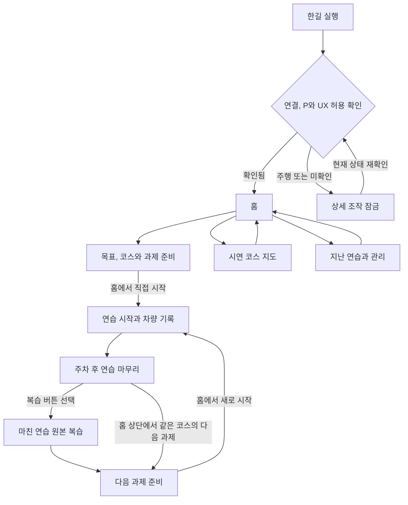
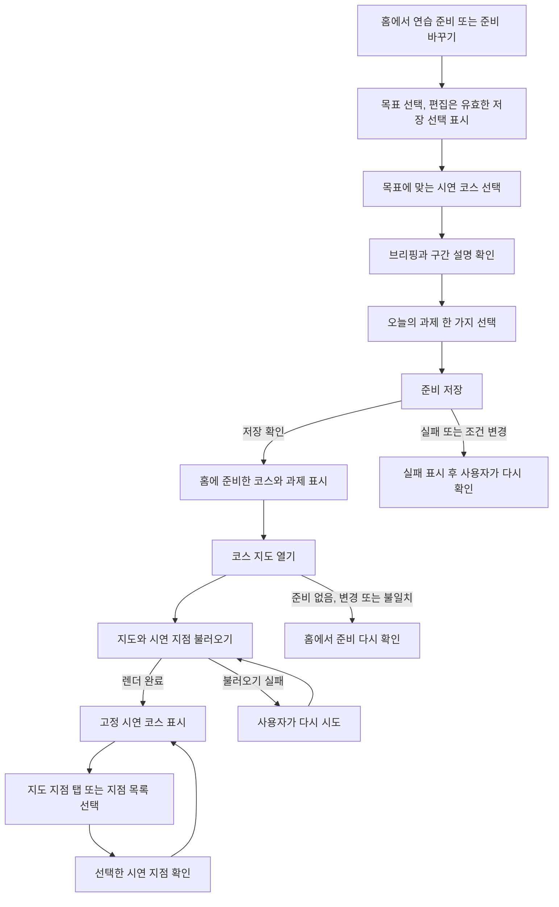
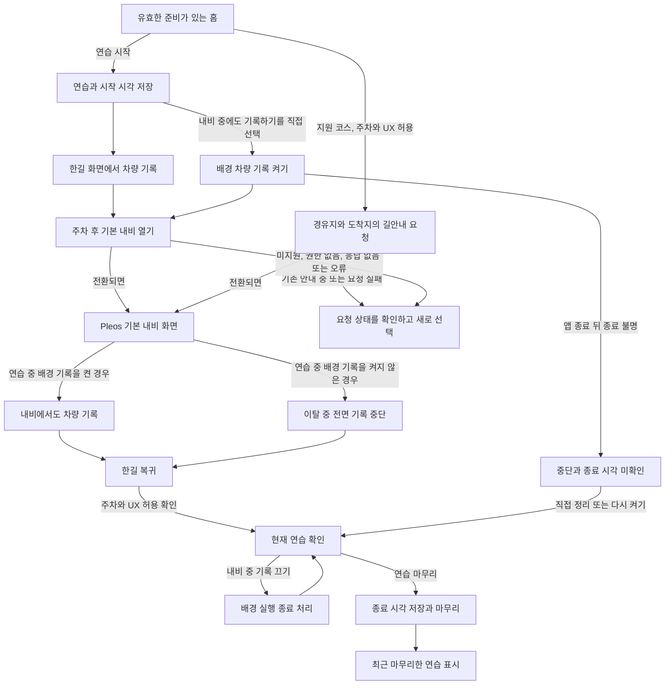
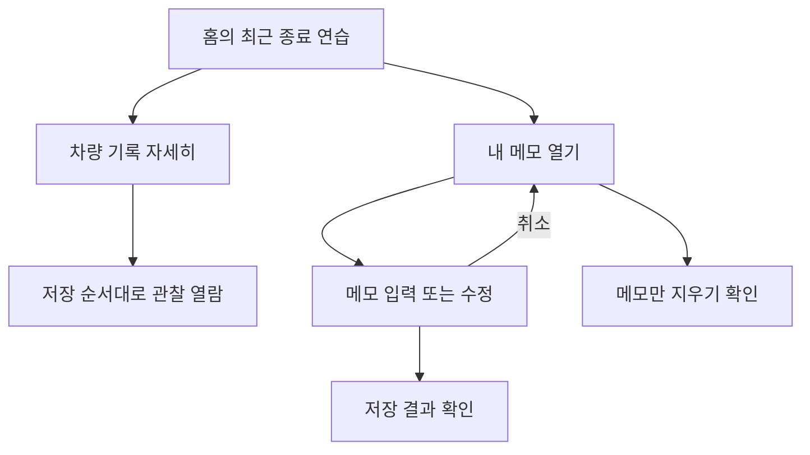
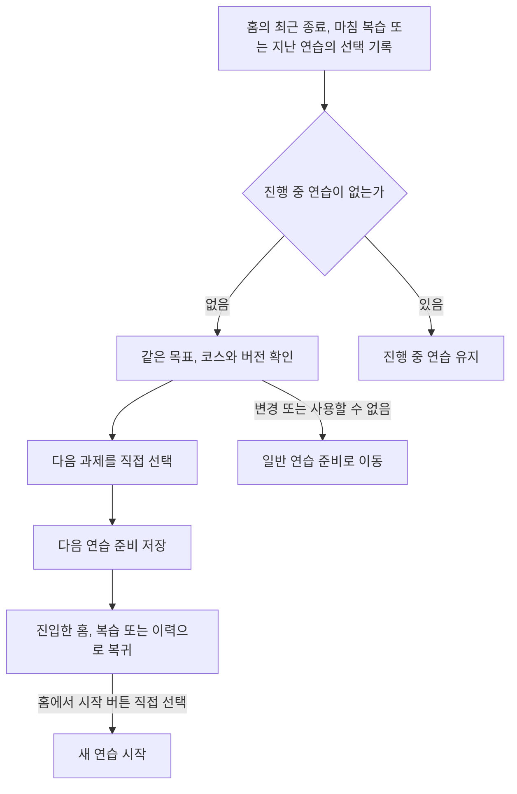
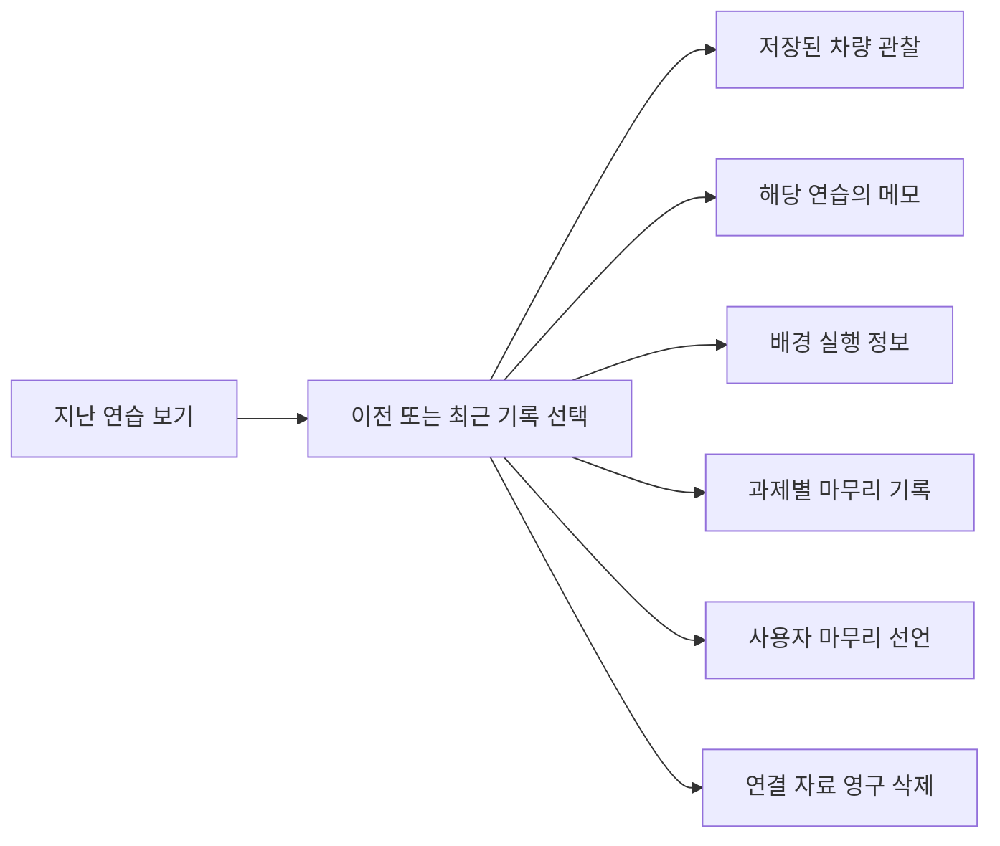
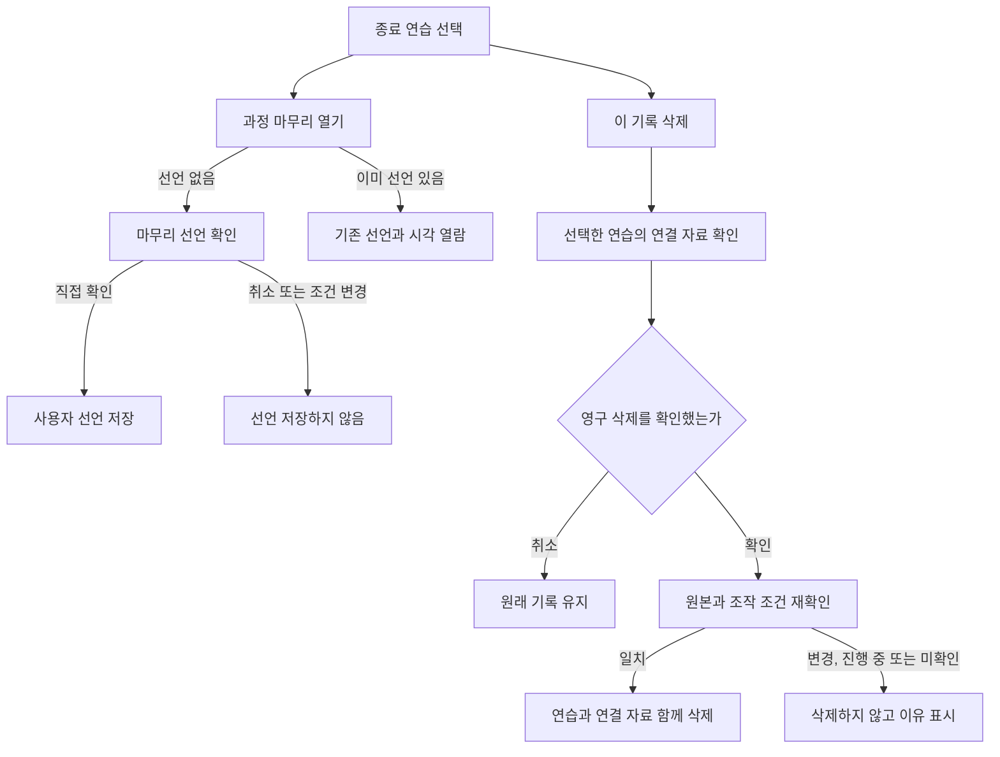
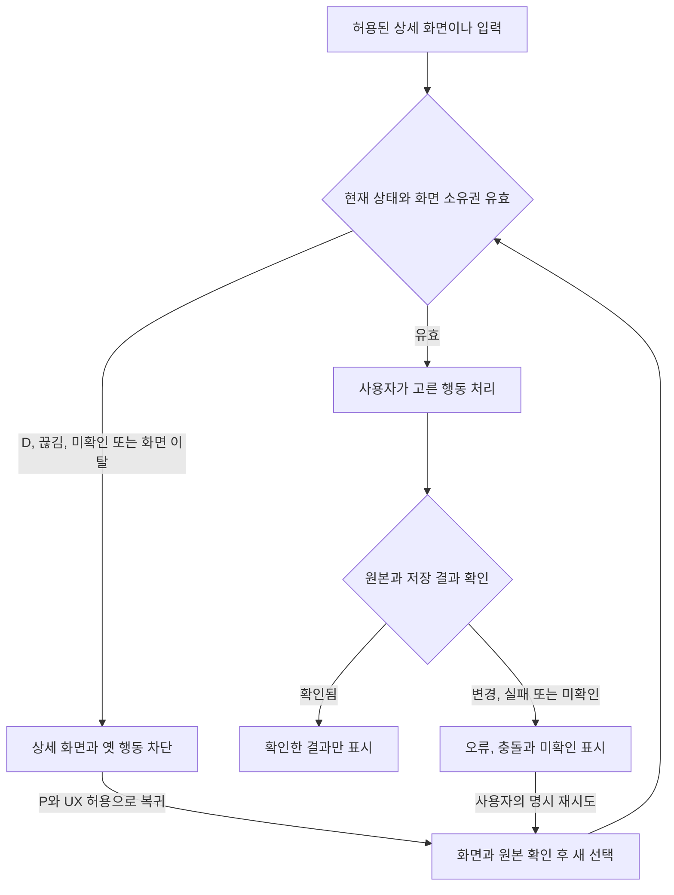
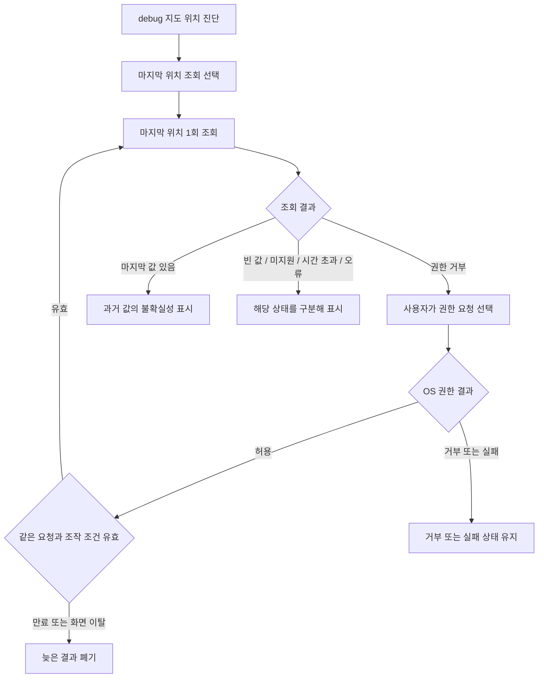

# 한길 앱 전체 사용 흐름

이 도식은 현재 코드의 화면 연결과 사용자 행동을 설명한다. 새 앱 실행이나 이번 실기 성공을 증명하는 화면은 아니다. 기본 내비, 실제 SDK 차량 관찰, 고정 시연 코스와 사용자 메모의 출처를 구분한다.

## 전체 동선

별도의 회원가입, 로그인이나 첫 실행 온보딩 화면은 현재 연결되어 있지 않다. 앱은 홈에서 시작한다. 준비와 지도, 지난 연습, 다음 연습은 별도 목적지이며 연습 시작/종료와 최근 기록, 기본 내비 요청은 홈 안의 행동이다.

같은 준비로 연습을 마친 홈은 다음 과제 선택을 주행동으로 제공한다. 같은 과제 반복과 목표/코스 변경은 보조행동이며, 다음 과제를 위해 목표/코스를 처음부터 다시 고르지 않는다. 모든 선택을 한 화면으로 합치지 않고 현재 맥락을 재사용하는 범위만 단축한다.

## 준비와 지도

같은 코스/버전/브리핑에서 과제를 고른 뒤 뒤로 갔다가 현재 코스를 다시 눌러도 유효한 과제를 유지한다. 코스나 버전, 과제 유효성이 바뀌면 다시 선택한다.

준비 저장은 연습 시작과 별개다. 지도 지점은 고정 시연 자료이며 실제 주행 경로, 현재 위치나 길안내 경로를 의미하지 않는다. 지도 조회 실패나 미확인 상태를 빈 정상 지도나 실제 경로로 바꾸지 않는다.

## 연습, 내비와 차량 기록

기본 내비 열기는 화면 전환을 요청한다. 별도의 길안내 버튼은 주차와 UX 허용이 확인된 상태에서 판교를 거쳐 양재까지 코스의 경유지와 도착지를 Pleos에 보낸다. 기존 안내 중이면 새 요청을 막고, 화면 전환과 실제 안내 시작을 구분한다.

사용자가 켠 배경 기록의 수집 범위는 차량 상태다. 위치와 경로는 수집 대상에서 제외하며, 중간 상태와 앱이 종료된 동안의 수집은 보장하지 않는다.

주행 중에는 연습 마무리, 메모와 상세 복습을 조작할 수 없다. 상세 화면의 잠금과 이미 시작한 차량 기록 수집은 서로 다른 동작이다.

## 최근 연습, 지난 연습과 다음 준비

지난 연습 화면의 기존 메모 수정은 진행 중인 연습이 없어야 하며 현재 주차/UX 조건도 허용되어야 한다. 홈의 최근 메모는 같은 최신 종료 원본과 현재 주차/UX 조건을 확인하는 별도 편집 흐름이다. 빈 메모와 글자 수 제한, 원본 변경, 저장 충돌과 결과 미확인은 별도로 표시한다. 최근 메모만 지우기는 연습과 차량 기록을 삭제하지 않는다.

다음 준비는 홈의 최근 종료 기록 또는 복습에서 선택한 종료 원본의 목표, 코스와 버전을 확인한 뒤 과제를 직접 고르는 흐름이다. 마침 복습에서 취소하면 같은 복습으로 돌아간다. 실제 도로 구간 기반 추천은 후속 범위다. 배경 실행 시각은 실제 연속 수집 기간을 증명하지 않는다.

## 과정 마무리와 삭제

과정 마무리는 선택한 연습에 대한 사용자의 선언이다. 자동 운전 능력 평가나 전역 과정의 이수 인증이 아니다. 영구 삭제는 확인한 연습과 연결 자료에 한정되며 삭제 성공 전에는 사라진 것으로 표시하지 않는다.

## 모든 상세 흐름에 적용되는 잠금과 실패

P로 돌아와도 이전 삭제 확인, 내비 요청이나 거부된 클릭을 자동 실행하지 않는다. 누락, 미지원과 오류를 0이나 정상 값으로 바꾸지 않는다.

## debug 전용 진단

일반 사용 흐름과 구분되는 debug 기능이다. 홈의 차량 진단에서 현재 연결과 SDK 상태를 확인하고, 지도의 위치 진단에서 마지막 알려진 위치를 명시적으로 조회한다. 권한이 없으면 별도 권한 요청을 사용자가 선택할 수 있다.

debug 진단은 마지막 위치를 한 번 조회한다. 제품의 전면 위치 기록은 사용자가 진행 중인 연습에서 따로 켜며, 화면 이탈, 권한 상실 또는 연습 종료 시 멈춘다. 주차 후 해당 연습의 위치 표본과 저장된 중단 원인을 확인할 수 있다.

## 남은 연결과 검증

실제 도로 복습 지도와 실제 구간 기반 다음 연습은 후속 범위다. 지원 코스의 경유지, 도착지와 안내 시작은 Pleos에서 확인했으며, 지도 타일 표시와 실제 도로 경로의 일치는 별도 검증이 필요하다.

## 코드 연결

| 사용자 행동 | 현재 구현 |
|---|---|
| 홈과 별도 목적지 이동 | [MainActivity](../../app/src/main/kotlin/io/github/hangillab/hangil/MainActivity.kt), [HomeScreen](../../feature/home/src/main/kotlin/io/github/hangillab/hangil/feature/home/HomeScreen.kt) |
| 목표, 코스, 브리핑과 과제 준비 | [CourseScreen](../../feature/course/src/main/kotlin/io/github/hangillab/hangil/feature/course/CourseScreen.kt) |
| 연습 시작/마무리와 최근 연습 | [SessionPanel](../../feature/home/src/main/kotlin/io/github/hangillab/hangil/feature/home/SessionPanel.kt), [SessionViewModel](../../feature/home/src/main/kotlin/io/github/hangillab/hangil/feature/home/SessionViewModel.kt) |
| 지도와 고정 시연 지점 선택 | [MapScreen](../../feature/map/src/main/kotlin/io/github/hangillab/hangil/feature/map/MapScreen.kt) |
| 기본 내비 열기와 지원 코스 길안내 | [NavigationScreenRoute](../../feature/home/src/main/kotlin/io/github/hangillab/hangil/feature/home/NavigationScreenRoute.kt) |
| 명시적인 배경 차량 기록 | [BackgroundRecordingRoute](../../feature/home/src/main/kotlin/io/github/hangillab/hangil/feature/home/BackgroundRecordingRoute.kt), [VehicleRecordingService](../../app/src/main/kotlin/io/github/hangillab/hangil/VehicleRecordingService.kt) |
| 지난 연습, 차량 관찰과 배경 실행 | [SessionHistoryScreen](../../feature/home/src/main/kotlin/io/github/hangillab/hangil/feature/home/SessionHistoryScreen.kt) |
| 최근/이전 연습의 메모 | [SessionMemoEditor](../../feature/home/src/main/kotlin/io/github/hangillab/hangil/feature/home/SessionMemoEditor.kt), [HistorySessionMemoEditor](../../feature/home/src/main/kotlin/io/github/hangillab/hangil/feature/home/HistorySessionMemoEditor.kt) |
| 과정 마무리 선언 | [HistoryCourseCompletionRoute](../../feature/home/src/main/kotlin/io/github/hangillab/hangil/feature/home/HistoryCourseCompletionRoute.kt) |
| 다음 연습 준비 | [NextPracticeScreen](../../feature/course/src/main/kotlin/io/github/hangillab/hangil/feature/course/NextPracticeScreen.kt) |
| 상세 조작 허용 조건 | [PracticeInteraction](../../core/domain/src/main/kotlin/io/github/hangillab/hangil/core/domain/PracticeInteraction.kt), [VehicleState](../../core/domain/src/main/kotlin/io/github/hangillab/hangil/core/domain/VehicleState.kt) |
| debug 마지막 위치 진단 | [LocationProbeRoute](../../feature/map/src/main/kotlin/io/github/hangillab/hangil/feature/map/LocationProbeRoute.kt), [LocationProbeViewModel](../../feature/map/src/main/kotlin/io/github/hangillab/hangil/feature/map/LocationProbeViewModel.kt) |
